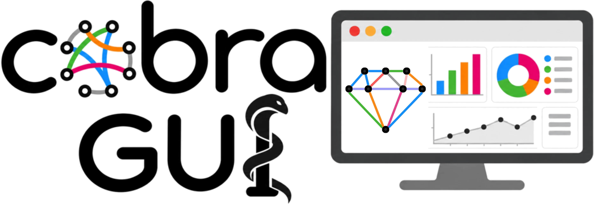

<p align="center">
  <picture>
    <source media="(prefers-color-scheme: dark)" srcset="docs/brand/gemsmap-logo-dark.png">
    
  </picture>
</p>

<h3 align="center">An interactive workbench for visualization and constraint-based analysis of genome-scale metabolic models</h3>

<p align="center">
   <a href="https://pypi.org/project/gemsmap/"></a> 
</p>

GEMs MAP is the visualization platform of genome-scale metabolic models (GEMs).
It takes a model from import to a publication-quality figure in one application:
explore and simulate it with COBRApy, compare conditions, then map the results onto pathway figures.
Think "Canva for metabolic networks" with COBRApy and pathway-style GEM semantics underneath.

The app has two workspaces, switched at the top left:

- **COBRAGUI** (COBRA graphical user interface): explore, edit and simulate the GEM with COBRApy, then compare results.
- **Map Builder**: build pathway figures, map fluxes, export SVG/PNG/PDF.

## Install (beta)

> **GEMs MAP 0.3 is in beta.** It works, but features and file formats can still change before the first stable
> release. Save your work as `.gemsmap` project files, and please [report problems](https://github.com/BatistaB/gemsmap/issues).

With Python 3.10 or newer, on Windows, macOS or Linux:

```bash
pip install gemsmap
gemsmap
```

`gemsmap` starts GEMs MAP and opens it in your browser at http://127.0.0.1:8765; keep the window open while you work.
Everything runs on your computer. Other ways, without Python:

- [uv](https://docs.astral.sh/uv/): `uvx gemsmap`.
- **Zip:** download `GEMsMAP-<version>.zip` from [Releases](https://github.com/BatistaB/gemsmap/releases), extract it and
  double-click *Start GEMs MAP* (Windows `.bat`, macOS `.command`; Linux: `bash start-gemsmap-linux.sh`). The first
  start prepares Python and GEMs MAP inside that folder; `README-FIRST.txt` explains the rest.

To report a problem, click **GEMs MAP &lt;version&gt;** in the COBRAGUI status bar, then *Copy diagnostics*, and paste it
into a [new issue](https://github.com/BatistaB/gemsmap/issues/new/choose) (or run `gemsmap diagnose`).

## Development

```bash
npm install
npm run backend:setup   # once: creates backend/.venv with COBRApy, FastAPI, uvicorn
npm run backend         # COBRApy backend on http://127.0.0.1:8765 (keep it running)
npm run dev             # http://localhost:5173 (proxies /api to the backend)
npm run build           # static build in dist/
npm run backend:test    # backend API tests (E. coli core)
```

**Documentation:** the user guide (COBRAGUI, Maps, Templates, reference) is a MkDocs site in [`docs/`](docs/index.md),
built by Read the Docs from [`.readthedocs.yaml`](.readthedocs.yaml). Preview it locally with
`pip install -r docs/requirements.txt` and `mkdocs serve`; see [docs/CONTRIBUTING.md](docs/CONTRIBUTING.md).

### The name and the logo

**GEMs** are genome-scale metabolic models, and gems. The mark is a gem cut from a metabolic network:
nodes are metabolites and edges are reactions, coloured like a flux map (red and blue for the two directions,
paler for smaller fluxes). The cobra around the **P** stands for COBRA (constraint-based reconstruction and
analysis), which runs COBRAGUI through COBRApy. Logo files, colours and usage: [docs/brand](docs/brand/README.md).

Up to version 0.2 the project was called *MetMap*. Its `.metmap` projects and `*.metmap-template.json` templates
still open, and its browser storage (autosaved map, templates, COBRAGUI sessions) moves to the new name on the
first start.

## COBRAGUI

<p>
  <picture>
    <source media="(prefers-color-scheme: dark)" srcset="docs/brand/cobragui-logo-dark.png">
    
  </picture>
</p>

A graphical interface for COBRApy. All science runs in Python; the browser never computes fluxes.

**Workflow:** import a model → inspect it → configure the medium → choose the objective → run pFBA → sort and filter the results → walk the network → send reactions and results to the Map Builder.

- **Import:** SBML, COBRA JSON or MATLAB `.mat` (drop the file or use *Import model*). COBRApy reads and validates the model. The dashboard lists non-blocking notes, such as dead ends, missing gene associations, unbalanced reactions and SBML messages. Each note links to the entities involved. Two models bundled with COBRApy are available as examples.
- **Explore:** metabolite, reaction and gene tables, virtualized for genome-scale models. Search covers ids, names, formula, equation, participant names, genes, subsystem, EC and annotations. Sort by flux or |flux| in one click, hide zero flux, filter by flux, bounds, type, gene association, subsystem or compartment (active filters show as chips), save views, and use the subsystem browser. Double-click LB/UB to edit.
- **Inspector and navigation:** click any metabolite, reaction or gene — in a table, an equation, a GPR, search results or the local network — to inspect it. Back/forward (Alt ←/→) and breadcrumbs keep the path. A metabolite lists producing and consuming reactions, split by the sign of the actual flux. A reaction shows its clickable equation, flux, FVA interval, bounds editor (original → current), GPR and a 1–2 hop local network.
- **Model states:** scenarios such as WT or Low O₂ hold bound overrides and an objective. Every change is recorded (undo/redo, revert, export). *Duplicate state* is the quickest way to set up a comparison. The imported file is never modified; *Save as model* writes a new SBML/JSON/MAT file.
- **Metabolite analysis (MetaNetX):** maps every metabolite to MetaNetX / MNXref through the identifiers already in the model (annotation, and IDs such as `C00031[c]`, `cpd00027_c0`, `glc__D_c`). Confident matches add the missing cross-references to the annotation: MetaNetX ID, KEGG, ChEBI, BiGG, ModelSEED, MetaCyc, HMDB, VMH, InChIKey, plus a formula where the model has none. Disagreeing identifiers, formula conflicts and name-only matches wait for your review, with the evidence for each candidate. Existing annotation is never removed, every match can be undone, and the curation is part of *Save as model* (SBML MIRIAM annotations, with a provenance note). Answers are cached locally, so only the first run needs the internet. Details: [docs/METABOLITE_ANALYSIS.md](docs/METABOLITE_ANALYSIS.md).
- **Medium:** uptake limits read and written through COBRApy's `model.medium`. Search by compound name, metabolite id or exchange id. Presets: model file, minimal (COBRApy `minimal_medium`), rich, anaerobic, plus your own saved presets per model.
- **Simulation:** FBA, pFBA, loopless FBA and FVA, with explicit solver status. A non-optimal solve never shows fluxes. Instead it lists what to check (medium, objective, modified bounds, forced fluxes).
- **Stop:** a running FVA shows its progress and can be stopped, or stopped while keeping the intervals already computed.
- **Publication figures:** in the Subsystems tabs, *Bars*, *Heatmap* and *Donut* turn the open subsystems (or their Σ|flux| totals) into a journal-sized figure, with several results side by side, saved as SVG, PDF or PNG at 600 dpi.
- **Subsystems:** in Results, a ranked overview of the subsystems (Σ|flux|, active reactions, mean |flux|) and the signed flux of their reactions, together or as separate panels. In Compare, a dumbbell A → B per subsystem shows which parts of metabolism moved. The interactive list avoids pie charts (Σ|flux| is not a share of a whole); the donut figure is offered for the selected items, captioned as a share of Σ|flux|.
- **Import results:** Results → *Import* reads JSON (GEMs MAP or legacy GEM Explorer) and CSV/TSV flux or FVA tables, e.g. runs made with other models. They are compared by reaction id; the provenance records the source model and how many ids match.
- **Results:** each run is stored with full provenance: model checksum, state, objective, medium, modified bounds, parameters, solver, status and timestamp. Views include reactions, metabolite turnover, exchanges (uptake/secretion), genes, and *How was this generated?*. Export as JSON or CSV.
- **Compare:** any two results, with no file round-trip. The configuration diff comes first, then reactions, turnover and exchanges with Δ, |Δ|, log₂FC and fold change. Rows are classified before any ratio is taken: activated from zero, inactivated to zero, and direction reversal never get a fold change. A pseudocount is optional and explicit. Click a metabolite to see *flux contributions to turnover change*, which is descriptive, not causal. Model states can also be compared before simulating.
- **To the Map Builder:** *Add to Map* takes reactions, metabolites, a subsystem or the selection, and auto-lays out a new block. *Visualize result* suggests mappings: |flux| → width and flux → colour. *Visualize comparison* maps log₂FC or Δ to a diverging colour and |flux| to width. Model ids are preserved, so nothing is matched by hand. *Focus in map* and *Inspect in COBRAGUI* jump between the two workspaces.

Scientific rules, enforced in the backend:

- pFBA reports the biological objective value; the minimized total flux is kept separately.
- FVA returns intervals only. Midpoints are never treated as a flux distribution.
- Metabolite turnover is 0.5·Σ|S·v|, labelled as a derived proxy. It shows "—" when there is no flux vector.
- Zero is a configurable numerical threshold (status bar), not exact equality.

Keyboard (COBRAGUI): `Ctrl K` or `/` search and commands · `F` focus table search · `R` `M` `G` tabs · `Alt ←/→` back/forward · `Ctrl Z` / `Ctrl Shift Z` undo/redo model changes · `Ctrl Enter` run · `I` toggle inspector · `Alt 1–6` sections.

### Backend

`backend/` is a FastAPI service over COBRApy, structured as one module per concern:

| Module | Responsibility |
|---|---|
| `services/model_service.py` | Import and validation, UI catalog, applying a model state inside `with model:` |
| `services/medium_service.py` | Medium table, edits and presets through `Model.medium` |
| `services/simulation_service.py` | FBA / pFBA / loopless / FVA, turnover, exchanges, metadata |
| `services/comparison_service.py` | Result-vs-result comparison, turnover contributions |
| `services/search_service.py` | Normalized multi-field search index |
| `services/export_service.py` | Result JSON/CSV, modified-model SBML/JSON/MAT |

Model states belong to the frontend and are sent with every request, so the backend is stateless apart from the loaded models. Results are reproducible from their metadata. Imported files are cached in `%LOCALAPPDATA%/cobragui/models` (override with `COBRAGUI_CACHE`) so a restarted backend reloads them. All COBRApy work runs on one worker thread, because GLPK aborts when a problem is used from several threads.

Main routes: `POST /api/models/import` · `GET /api/models/{id}` (+ `/summary`, `/reactions`, `/metabolites`, `/genes`, `/search`) · `POST /api/models/{id}/medium/query` · `PUT /api/models/{id}/medium` · `POST /api/models/{id}/medium/preset` · `POST /api/models/{id}/simulate/{fba|pfba|loopless|fva}` · `POST /api/models/{id}/explain-turnover` · `POST /api/models/{id}/export` · `POST /api/results/compare` · `POST /api/results/export`.

Measured on iML1515 (2,712 reactions) with GLPK: SBML import about 20–25 s on first load, FBA 0.8 s, pFBA 4 s, full FVA about 95 s. For a quick FVA on large models, run it on a selection.

The app always opens clean, on an empty canvas; work is autosaved to the browser every 5 minutes, and the welcome banner offers to continue the last session. *File → Open example* (or the button on the empty canvas) loads the **Central Carbon Metabolism demo**: glycolysis, the PPP and a circular TCA cycle, with four simulated conditions (P10, P12, P26, P28), flux-sampling density plots and a legend.

In the Map Builder, press **C** for the hand and drag to move around the map, **V** to go back to selecting, and use the **mouse wheel** to zoom. Switching between C and V is the recommended way to work.

### Project layout

```
src/
  lab/          COBRAGUI: store, API client, search, bridge to the map, UI
  ui/           Map Builder UI (canvas, panels, inspector, palette) + shared pieces
  model/ data/  GEM types and importers, datasets and CSV parsing
  viz/ layout/  visual mappings, palettes, geometry, layout algorithms
  store/        Map Builder state, undo/redo, .gemsmap format
backend/        COBRApy service (FastAPI) + tests
tools/          offline scripts (release build, docs screenshots, KEGG templates, BiGG data)
public/         demo examples served by the app
docs/           documentation site (MkDocs, Read the Docs) and technical notes
```

See [CONTRIBUTING.md](CONTRIBUTING.md) for the development workflow and commit conventions, and
[CHANGELOG.md](CHANGELOG.md) for the release history.

### Private data

Keep unpublished models, projects and results in `my_projects/` (open projects with **File → Open project…**):
the folder is git-ignored, and release builds contain only files that git tracks. Personal ignore patterns belong
in `.git/info/exclude`, which is never committed. The app itself ships only the central-carbon example
(**File → Open example**).

## The 5-minute workflow

1. **Model tab → Import GEM.** Accepts COBRApy/BiGG JSON or SBML (fbc). You can also drop the file on the window.
2. **Elements tab → "Central carbon metabolism" template.** The template maps itself onto the model; you confirm only the uncertain slots, then the pathway is drawn.
3. **Data tab → Import fluxes.** For example `reaction,P10,P12,P26,P28`. Conditions are detected, IDs are matched (with a % report and manual mapping), and width and colour mappings are created.
4. Select reactions and press **P**, or use the right-click menu, to add linked mini-plots (density, bar, line, heatmap, box, FVA range).
5. **Export:** SVG (editable, sized in mm for journal columns), PNG at 150/300/600 dpi, or PDF.
6. **Animated comparison:** Export → **GIF** plays the figure through the conditions you tick (e.g. 30 h → 56 h → 80 h), with smooth transitions and the condition name on each frame.

Example files are in `public/examples/`: `pfba_4conditions.csv`, `fva_2conditions.csv` and `timecourse.csv`. The pathway templates are tested against e_coli_core, iJO1366, a ModelSEED-namespace copy and an annotation-free copy of e_coli_core (`npm test`).

## Pathway templates: one figure language for any GEM

Glycolysis, the TCA cycle, the oxidative PPP and their composition (central carbon) are **model-agnostic**: a template slot names a biological entity (D-glucose 6-phosphate @ cytosol), never a model ID. The template also carries its **layout**: glycolysis stays vertical, the TCA cycle stays a circle, whatever the model. Mapping fills the slots and never moves them.

When you pick a template with a model loaded, a review dialog lists only the slots that need you:

- Every slot gets ranked candidates. Each candidate shows **why it matched**: cross-references in the model annotation (KEGG, ChEBI, BiGG, ModelSEED, MetaCyc, HMDB…), IDs such as `C00031[c]` / `cpd00027_c0` / `glc__D_c`, names (stereochemistry kept: D ≠ L), formula (H ignored), the **compartment**, and whether a chemical reaction links it to the neighbouring slots (transporters and currency metabolites don't count).
- Compartments are normalized (`c`, `c0`, `cyto`, "Cytoplasm" → cytosol) and the model is characterised as eukaryote- or prokaryote-like. The TCA cycle prefers the mitochondrion when the model has one and falls back to the cytosol otherwise, and the dialog says so.
- **High** confidence is mapped automatically. **Medium** is mapped provisionally and marked with a yellow **?**. When two candidates are equally plausible, or nothing fits, the slot stays **open**: an unresolved slot is better than a wrong one. Example: when a model enters glycolysis through both the α- and the β-anomer of glucose 6-phosphate, GEMs MAP asks which one to draw.
- Your choices go into the model's **mapping profile** (keyed by a structural fingerprint, and also saved in the `.gemsmap` project). They are reused by every template that shares the entity, but never by an unrelated model.
- Click a node on the map to change, confirm or clear its mapping, or mark the entity as absent. **Export report** writes every mapping with its evidence, method and versions as JSON.

The badge in the gallery (e.g. `9/11`) is **template coverage** of the model, not pathway activity. Specs, schema and scoring are described in [docs/TEMPLATES.md](docs/TEMPLATES.md).

## Template Builder: design pathway templates without a model

The **Templates** workspace creates, edits, reviews, imports and exports model-independent templates
(`*.gemsmap-template.json`). A template knows *what* each molecule is (D-glucose: KEGG C00031, ChEBI, BiGG,
ModelSEED, MetaNetX…, in the cytosol); the matcher discovers *what it is called* in each GEM.

- The built-ins (Global central carbon metabolism, Glycolysis, TCA, PPP) are ordinary template files: open one,
  duplicate it ("TCA Cycle — Aspergillus version"), change compartments, branches or labels.
- Draw on the Map Builder canvas with the same gestures. Double-click a node, type `glucose`, pick the compound:
  the node becomes a confirmed template entity. Candidates come from the GEMs MAP library (offline) and from
  KEGG / ChEBI resolved through MetaNetX (with the backend). Reactions get identities from their participants.
- **Auto Identify** suggests identities for everything not confirmed; the **review queue** lists every element
  with its identity status (✓ confirmed · ? suggested · ! ambiguous · ○ unresolved). Confirmed identities are never
  overwritten by suggestions.
- **Validate** reports missing identities, duplicates, broken edges, unbalanced equations and model-like IDs;
  **completeness** is three plain ratios.
- **Apply to GEM** runs the mapping review dialog on the loaded model. The same file maps a BiGG, a ModelSEED
  or a KEGG-namespace model, and missing parts stay open instead of failing.
- **BiGG data layer** (`npm run bigg:data`, once): the universal metabolites and reactions of BiGG feed the identity
  search, identify reactions from their full stoichiometry and compartment, and **Add BiGG IDs** gives templates
  the IDs that models downloaded from BiGG use. Models exported by bigg.bio are normalized on import.

Details: [docs/TEMPLATE_BUILDER.md](docs/TEMPLATE_BUILDER.md).

## Shapes and your own templates: draw the map first, bind later

Slots (dashed circles) and free arrows can be drawn before any model is loaded. Press **S**, or drag from a node's outer ring and drop on empty canvas to extend a chain. Each slot carries compartment-free hints (`g6p`, `glucose 6-phosphate`), so **Auto-bind** resolves it to `g6p_c` in one model and `g6p[c]`/`M_g6p_c` in another.

Arrows bind to the model reaction that links their endpoints. That can be a direct reaction or a two-step series, which is shown as one *lumped* arrow (for example ACONTa+ACONTb). If an arrow is drawn against the reaction's stoichiometric direction, it is flagged and its flux sign is flipped for display.

To reuse a layout, select it and choose **Save as template**. The bindings are turned into hints, so the template works with any GEM.

## Model-driven editing

- **Connected reactions:** select a metabolite. In the Inspector, hover a reaction chip for its name, equation, GPR and bounds; click it to add that reaction to the map. The reaction brings **its own copies** of its metabolites (it never links itself to nodes drawn elsewhere), and extra participants start hidden. Hide a copy, or **drag it onto a node of the same metabolite** — a green ring shows *release to merge* — to join them.
- **Routes:** select a free arrow (for example glucose → pyruvate) and choose **Find routes**. The model's alternative routes are listed shortest first. *Insert* draws every reaction with **new copies** of the intermediate metabolites (drag a copy onto the same metabolite to merge); *Collapsed* inserts them as one summary arrow.
- **Collapse:** select arrows, or just two metabolites, then **Collapse**. The hidden sub-network is stored inside one summary arrow and **Expand** restores it. The arrow's flux defaults to the *net flux entering the segment*: the sum for parallel reactions, the through-flux for a chain. Sum, mean, min and max are also available.
- **Participants:** for reactions with many metabolites, untick participants in the Inspector to hide them. A `+N` marker on the canvas shows hidden ones. Expanding the network now creates one hyperedge per reaction, and duplicate arrows can be merged.

## Enzyme-constrained models (ecModels)

ecModels (GECKO) split a reaction into per-isozyme and per-direction copies — `r101` becomes `r101_EXP_1…3`
and `r101_REV_EXP_1…3`, and `r262` becomes `r262` + `r262_REV`. GEMs MAP folds them back automatically, for any
model and data source (CSV, COBRAGUI results, result JSON), so a map drawn on the original model works with the
ecModel and its fluxes:

- **Data:** an arrow bound to `r101` shows the family's **net flux** = Σ forward copies − Σ `_REV` copies
  (element-wise for sampling, outer bound for FVA). Copies keep their own id at import, so ecModel fluxes also
  work on maps bound to the original (non-ec) model.
- **Model:** a missing parent is rebuilt as a virtual reaction (metabolic stoichiometry, enzyme pseudo-metabolites
  `prot_*` removed, isozyme GPRs merged with `or`). Virtual reactions drive search, connected reactions and
  routes, and are never exported or saved.
- Enzyme pseudo-metabolites (`prot_*`, `pmet_*`) are treated as currency and never drawn.
- Models larger than ~2 MB are autosaved to IndexedDB instead of local storage, so the autosaved session keeps them.

## Architecture

The modules are independent, and data and visuals are never coupled:

| Layer | Path | Responsibility |
|---|---|---|
| Biology | `src/model/` | `Metabolite`, `Reaction` (stoichiometric hyperedges), `MetabolicModel`; COBRA JSON / SBML import; validation; graph queries (expand, shortest path, currency-aware); fuzzy search |
| Data | `src/data/` | `Dataset`, `Condition`; CSV/TSV parsing (wide, FVA min/max, long-format samples); ID matching; KDE/quantiles |
| Visualization | `src/viz/` | Glyph types (`NodeGlyph`, `ReactionGlyph`, `PlotGlyph`, `PathwayGroup`…), `VisualizationMapping`, palettes, style presets, the pure mapping engine (`evaluate.ts`), geometry |
| Layout | `src/layout/` | Layered vertical/horizontal, circular, grid, hierarchical, organic, align/distribute, tidy |
| Templates | `src/templates/` | Template file format (`format/`), built-in template files, library, Template Design Mode (`design/`), mapping engine (`mapping/`), auto-binding |
| State | `src/store/` | Zustand store, undo/redo snapshots, the `.gemsmap` project format |
| Rendering/UI | `src/ui/` | SVG scene (attributes only, so the export stays editable), canvas interactions, panels, command palette |
| Export | `src/export/` | Clean SVG builder, PNG with DPI metadata, print-to-PDF, autosave |

Scientific choices:

- Flux domains are computed across **all** conditions, so switching condition never silently rescales the map.
- Arrows encode direction, so colour defaults to |flux|. Comparisons (Δ, fold change, log₂FC) use diverging palettes.
- Zero flux is drawn thin and muted.
- Concentration and turnover are different dataset kinds and are never conflated.
- Currency metabolites (ATP, NAD(P)H, H₂O, H⁺, Pi, CoA, …) are hidden from maps, expansion and path-finding. They can be shown as inline cofactor text.

## Shortcuts

`V` select · `M` metabolite · `S` slot · `R` reaction · `T` text · `C`, hold Space + drag, or right-drag to pan · `L` lock the selection (locked items are skipped by clicks and box selection; hold the mouse 3 s on one, or right-click it, to unlock) · `P` plot · `Ctrl K` command palette · `Ctrl Z / Ctrl Shift Z` undo/redo · `Ctrl C/V/D` · `Ctrl G` group · `L` lock · `F` fit · `[` `]` previous/next condition · Shift-drag constrains to 0/45/90° · Alt-drag ignores guides · `?` all shortcuts.

## Status

Implemented (MVP 1 and much of MVP 2):

- Canvas: infinite pan/zoom, grid with independent snap, smart guides, multi-select/box select, minimap
- Editing: undo/redo, copy/paste, lock, groups/compartments
- Model: GEM JSON + SBML import, search, expand up/downstream, shortest path
- Layout: vertical/horizontal/circular/grid/hierarchical/organic layouts, align/distribute/tidy
- Data: CSV/FVA/samples/time-course import, width/colour/opacity/label mappings for reactions, radius/fill for metabolites
- Comparison: condition toggle, Δ / FC / log₂FC, saved views, play/loop/ping-pong animation, flux particles
- Plots and legend: six linked mini-plot types, auto legend, style presets
- Files: SVG/PNG/PDF export, `.gemsmap` save/load, autosave, command palette

Next steps (COBRAGUI):

- Gene knockout simulation, flux sampling, FVA progress/cancellation
- Better auto-layout for loosely connected reaction sets sent from COBRAGUI

Next steps (Map Builder):

- Rulers and lasso selection; manual edge control points beyond the single bend handle; obstacle-avoiding routing
- Multi-panel figure frames; legend text editing
- WebGL rendering for very large GEMs
