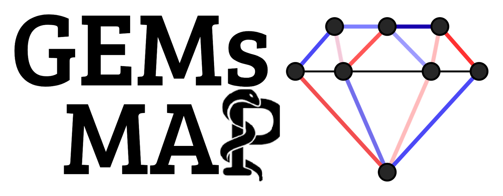
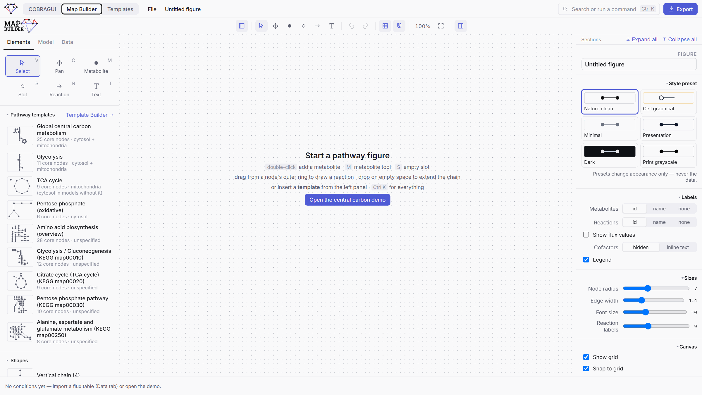
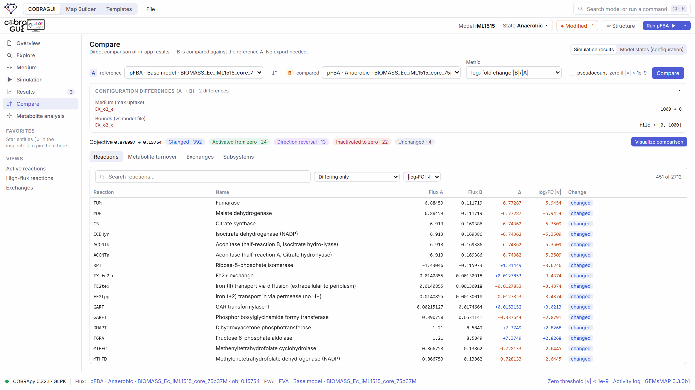

<p align="center">
  <picture>
    <source media="(prefers-color-scheme: dark)" srcset="docs/brand/gemsmap-logo-dark.png">
    
  </picture>
</p>

<h3 align="center">An interactive workbench for visualization and constraint-based analysis of genome-scale metabolic models</h3>

<p align="center">
   <a href="https://pypi.org/project/gemsmap/"></a> <a href="https://gemsmap.readthedocs.io/"></a> 
</p>

GEMs MAP takes a genome-scale metabolic model (GEM) from import to a publication-quality figure in one application.
Explore and simulate the model with [COBRApy](https://opencobra.github.io/cobrapy/), compare conditions, then map
the results onto editable pathway figures, without writing every step as code.
Think "Canva for metabolic networks" with COBRApy and pathway-style GEM semantics underneath.
It runs on your own computer, and your models are not uploaded anywhere.

<p align="center">
  
  <br><sub>The built-in central carbon example in the Map Builder: arrow width and colour encode flux, and each density plot shows a flux distribution per condition. The example data are illustrative.</sub>
</p>

## Why GEMs MAP?

Asking a GEM a question is easy with COBRApy; **reading the answer** is harder. Flux vectors are long tables,
identifiers differ between models, and the figures that communicate a result are usually redrawn by hand, outside
the analysis. GEMs MAP keeps these steps together: every result stays inspectable (which medium, objective, bounds
and solver produced it), and the identifiers COBRApy uses are carried onto the map, so results bind to the drawing
without manual matching.

## What it does

The application has three workspaces that share the same model and data:

- **COBRAGUI** (COBRA graphical user interface): import SBML, COBRA JSON or MATLAB models; explore metabolites,
  reactions and genes; set the medium, bounds and objective; run FBA, pFBA, loopless FBA or FVA; compare results
  and export them. Metabolite identifiers can be curated against MetaNetX.
- **Map Builder**: draw or insert pathways, bind them to the model, map fluxes to arrow width and colour, switch
  between conditions or show their differences (Δ, log₂FC), add small linked plots, and export SVG, PNG, PDF or an
  animated GIF.
- **Templates**: reusable pathway layouts (central carbon metabolism, glycolysis, TCA cycle, pentose phosphate
  pathway, …) that describe biological identity rather than model IDs. A matcher finds what each molecule is
  called in your GEM and asks you to review uncertain cases.

<p align="center">
  
  <br><sub>COBRAGUI comparing two pFBA results of <i>E. coli</i> iML1515 (with and without oxygen).</sub>
</p>

## Install

> **GEMs MAP 0.3 is in beta.** It works, but features and file formats can still change before the first stable
> release. Save your work as `.gemsmap` project files, and please [report problems](https://github.com/BatistaB/gemsmap/issues).

With Python 3.10 or newer, on Windows, macOS or Linux:

```bash
pip install gemsmap
gemsmap
```

`gemsmap` starts GEMs MAP and opens it in your browser at http://127.0.0.1:8765; keep the window open while you work.
Other ways, without Python:

- [uv](https://docs.astral.sh/uv/): `uvx gemsmap`.
- **Zip:** download `GEMsMAP-<version>.zip` from [Releases](https://github.com/BatistaB/gemsmap/releases), extract it and
  double-click *Start GEMs MAP* (Windows `.bat`, macOS `.command`; Linux: `bash start-gemsmap-linux.sh`). The first
  start prepares Python and GEMs MAP inside that folder; `README-FIRST.txt` explains the rest.

Requirements, virtual environments and troubleshooting: [Installation guide](https://gemsmap.readthedocs.io/en/latest/getting-started/installation/).

## Quick start

1. Start GEMs MAP with `gemsmap`. It opens in **COBRAGUI**.
2. Drop a model file (SBML, COBRA JSON or MATLAB `.mat`) on the window, or pick one of the example models
   bundled with COBRApy.
3. Adjust the medium, bounds or objective if needed, then run **pFBA** (FBA, loopless FBA and FVA are also
   available). Change a condition, run again, and open **Compare** to see what moved.
4. Click **Visualize comparison** to send the result to the **Map Builder**, insert a pathway template, and export
   the figure.

To see a finished map first, choose **File → Open example** for the central carbon demo shown above.
The [quick-start tutorial](https://gemsmap.readthedocs.io/en/latest/tutorials/quick-start/) walks through all of this with *E. coli* iJO1366 in
about 45 minutes.

## Scientific principles

GEMs MAP aims to make results easy to read without changing what they mean:

- **All flux computations run in COBRApy**, in Python on your computer; the browser never computes fluxes.
- **A failed solve never shows fluxes.** Every analysis reports its solver status; a non-optimal result lists what
  to check (medium, objective, modified bounds, forced fluxes) instead of showing zeros.
- **pFBA reports the biological objective value**; the minimized total flux is kept separately.
  **FVA returns intervals only**; midpoints are never treated as a flux distribution.
- **Every result records its provenance**: model checksum, model state, objective, medium, modified bounds,
  parameters, solver, status and time. The imported model file is never modified.
- **Comparisons classify before they divide**: reactions activated from zero, inactivated to zero or reversing
  direction never get a fold change.
- **Uncertain template matches wait for you**: an unresolved pathway slot is better than a wrong one.

What these analyses can and cannot tell you is described in [Limitations](https://gemsmap.readthedocs.io/en/latest/reference/limitations/).

## Documentation

The user guide is published at **<https://gemsmap.readthedocs.io/>**:

| | |
|---|---|
| [Getting started](https://gemsmap.readthedocs.io/en/latest/getting-started/) | Overview, [installation](https://gemsmap.readthedocs.io/en/latest/getting-started/installation/), [first look](https://gemsmap.readthedocs.io/en/latest/getting-started/first-look/) |
| [COBRAGUI](https://gemsmap.readthedocs.io/en/latest/cobra-gui/) | Importing, exploring and editing models; [constraint-based analysis](https://gemsmap.readthedocs.io/en/latest/cobra-gui/constraint-based-analysis/); results and comparison |
| [Maps](https://gemsmap.readthedocs.io/en/latest/maps/) | Drawing pathways, linking them to a model, displaying results, exporting figures |
| [Templates](https://gemsmap.readthedocs.io/en/latest/templates/) | The template library, identity matching, creating and sharing templates |
| [Reference](https://gemsmap.readthedocs.io/en/latest/reference/) | [Glossary](https://gemsmap.readthedocs.io/en/latest/reference/glossary/), [FAQ](https://gemsmap.readthedocs.io/en/latest/reference/faq/), [troubleshooting](https://gemsmap.readthedocs.io/en/latest/reference/troubleshooting/), [limitations](https://gemsmap.readthedocs.io/en/latest/reference/limitations/), [roadmap](https://gemsmap.readthedocs.io/en/latest/reference/roadmap/) |

## Project status

GEMs MAP 0.3 is a beta. Model import and editing, FBA, pFBA, loopless FBA and FVA, result comparison, the Map
Builder and template matching are implemented. Solver selection, flux sampling and gene knockouts are planned; see
the [roadmap](https://gemsmap.readthedocs.io/en/latest/reference/roadmap/). Changes between versions are listed in [CHANGELOG.md](CHANGELOG.md).

Projects from version 0.2 and earlier, when the application was called *MetMap*, still open: `.metmap` projects,
`*.metmap-template.json` templates and the browser storage of that version are carried over.

## Getting help

To report a problem, click **GEMs MAP &lt;version&gt;** in the COBRAGUI status bar, then *Copy diagnostics*, and
paste it into a [new issue](https://github.com/BatistaB/gemsmap/issues/new/choose) (or run `gemsmap diagnose`).
Feature requests are welcome in the same place.

## Contributing

To run GEMs MAP from source (Node.js 18+ and Python 3.10+):

```bash
npm install
npm run backend:setup   # once: creates backend/.venv with COBRApy, FastAPI, uvicorn
npm run backend         # COBRApy backend on http://127.0.0.1:8765 (keep it running)
npm run dev             # interface on http://localhost:5173 (forwards /api to the backend)
```

- [CONTRIBUTING.md](CONTRIBUTING.md): development workflow, tests, commit conventions and releases.
- [Architecture](docs/ARCHITECTURE.md): how the code is organised (interface, COBRApy backend, templates).
- [Contributing to the docs](docs/CONTRIBUTING.md): building and previewing the documentation site.

## License and acknowledgements

GEMs MAP is released under the [MIT License](LICENSE).

All simulations run in [COBRApy](https://opencobra.github.io/cobrapy/) (Ebrahim *et al.*, 2013, *BMC Systems
Biology* 7:74). Identifier curation uses [MetaNetX/MNXref](https://www.metanetx.org) and, when installed locally,
the universal tables of [BiGG Models](https://bigg.bio). GEMs MAP is an independent project and is not maintained
or endorsed by the COBRApy, BiGG, MetaNetX or KEGG teams.

The logo is a gem cut from a metabolic network, coloured like a flux map ([brand guide](docs/brand/README.md)).
How the project started: [the story of GEMs MAP](https://gemsmap.readthedocs.io/en/latest/history/).
