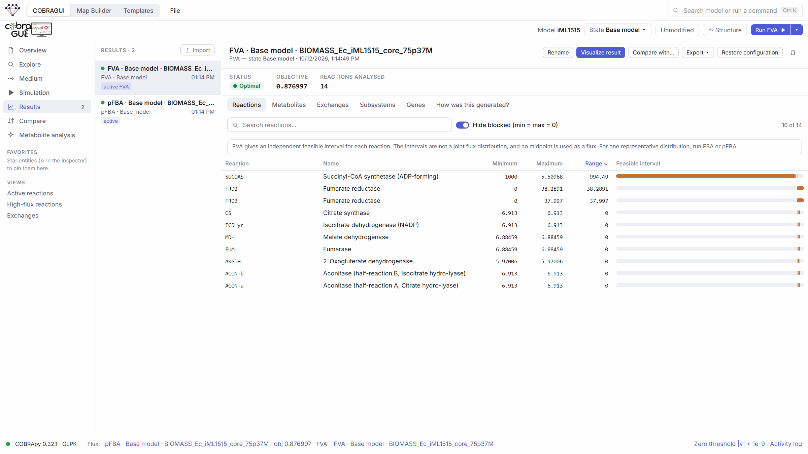

# Constraint-based analysis

The **Simulation** section of COBRAGUI runs four COBRApy methods on the active [model state](constraints.md#model-states): **FBA**, **pFBA**, **loopless FBA** and **FVA**. This page explains what each method computes, which options the interface exposes, and how to read the output.

<figure class="gm-shot" markdown>

<figcaption markdown="span">pFBA on *E. coli* iML1515 with the medium stored in the model file (glucose uptake ≤ 10 mmol gDW⁻¹ h⁻¹, aerobic). Conditions and values are listed in [About the examples](../reference/examples.md).</figcaption>
</figure>

<ol class="gm-callouts" markdown>
<li>Method cards. <em>Learn more</em> shows a short definition of each method.</li>
<li>What will be solved: objective, model state, medium. <em>Advanced options</em> holds the method parameters.</li>
<li>Run (also <kbd>Ctrl</kbd>+<kbd>Enter</kbd>, or the <em>Run</em> button in the top bar).</li>
<li>Result card: solver status first, then the objective value, totals and run time.</li>
</ol>

## The model behind every method

A metabolic model is a stoichiometric matrix \(S\) (metabolites × reactions) plus lower and upper bounds on each reaction flux \(v_j\). Constraint-based methods assume **steady state**: every internal metabolite is produced as fast as it is consumed.

\[
S\,v = 0, \qquad lb_j \le v_j \le ub_j \quad \text{for every reaction } j
\]

Fluxes are in mmol gDW⁻¹ h⁻¹ (millimoles per gram of dry weight per hour), the usual convention of genome-scale models; a biomass objective is then a growth rate in h⁻¹. GEMs MAP does not convert units: it shows what COBRApy returns for the model as written.

The set of flux vectors that satisfy these constraints is usually huge. Each method below picks out, or describes, a part of it.

## FBA — flux balance analysis

FBA solves a linear program: maximise (or minimise) a linear objective \(c^\top v\) subject to the constraints above.

\[
\max_{v}\; c^\top v \quad \text{s.t.}\quad S\,v = 0,\; lb \le v \le ub
\]

In GEMs MAP the objective is the one stored in the model file, or the one you set in the [objective editor](constraints.md#objective). The result is the optimal objective value and **one** flux vector that reaches it.

!!! warning "One optimum, many flux distributions"
    Many different flux vectors usually reach the same optimal objective value: parallel pathways, isozymes and cycles leave freedom that the objective does not constrain. FBA returns whichever optimal vertex the solver finds. Treat individual fluxes of an FBA solution as *one possible* distribution, not as the prediction of the model. [FVA](#fva-flux-variability-analysis) shows how much each flux can vary at the optimum; [pFBA](#pfba-parsimonious-fba) picks a more reproducible solution.

## pFBA — parsimonious FBA

pFBA (Lewis *et al.*, 2010) first finds the optimum, then keeps the objective at (a fraction of) that optimum and **minimises the sum of absolute fluxes**. The idea is enzyme economy: among equally good solutions, prefer the one that needs the least total flux.

- **Fraction of optimum** (Advanced options, default `1`): the objective must stay ≥ this fraction of the optimum while total flux is minimised.
- **Reported values.** The result's objective value is the **biological objective** \(\sum c_j v_j\) of the returned fluxes, recomputed by GEMs MAP; the minimised total flux is reported separately as *Total flux (pFBA)* (Σ|flux|). COBRApy's own `objective_value` for pFBA is the total flux, which is easy to confuse with growth; GEMs MAP keeps the two apart.
- pFBA solutions are more reproducible than plain FBA, but they can still be non-unique, and minimal total flux is a modelling assumption, not a measured property.

## Loopless FBA

Optimal solutions can contain **internal cycles**: sets of reactions that carry flux around a loop with no net change, which is thermodynamically infeasible. *Loopless FBA* runs COBRApy's `loopless_solution`, the CycleFreeFlux method (Desouki *et al.*, 2015): it removes such cycles from an optimal solution while preserving the objective value and the exchange fluxes. It has no extra parameters in the interface.

## FVA — flux variability analysis

FVA (Mahadevan and Schilling, 2003) asks, for **each reaction independently**: what are the smallest and largest fluxes compatible with the constraints while the objective stays at least at a given fraction of its optimum?

\[
\min / \max\; v_j \quad \text{s.t.}\quad S\,v = 0,\; lb \le v \le ub,\; c^\top v \ge f \cdot z^\ast
\]

where \(z^\ast\) is the optimal objective and \(f\) the *fraction of optimum*. Each reaction needs two optimisations, so FVA is the most expensive method.

| Option | Default | Meaning |
| --- | --- | --- |
| Fraction of optimum | `1` | \(f\) above. Lower values explore sub-optimal solutions. |
| Loopless FVA | off | COBRApy's loopless variant: excludes flux ranges that require internal cycles. Much slower. |
| Reactions | all | All reactions, or the reactions selected in the Explorer. |
| pFBA factor | off | If set (≥ 1), the total flux is also bounded to ≤ factor × the pFBA minimum. |
| Processes | `1` | Worker processes for COBRApy's FVA. |

**Reading FVA.** The result is a table of intervals, one per reaction, shown as numbers and range bars. A reaction with `min = max = 0` is blocked under these conditions; a narrow interval means the flux is well determined at the optimum; a wide one means the model leaves it free.

!!! danger "FVA intervals are not a flux distribution"
    Each interval is computed independently. Choosing a value inside every interval does **not** give a feasible flux vector, and the midpoints are not a solution. GEMs MAP never uses midpoints as fluxes: FVA results have no metabolite turnover, are sent to maps as **ranges** only, and can be compared only with other FVA results.

**Large models.** On iML1515 (2,712 reactions) a full FVA solves 5,424 linear programs. The README of the project reports about 95 s with GLPK on the author's machine. The interface warns about large runs and offers faster alternatives:

- *FVA on selection* in the Explorer action bar, or *FVA on subsystem* in the inspector of a subsystem;
- a running FVA shows its progress and can be stopped. *Stop & keep* saves the intervals already computed, as a result marked *stopped at n/N*; *Stop* discards the run.

<figure class="gm-shot" markdown>

<figcaption>FVA restricted to one subsystem (<em>Citric Acid Cycle</em> of iML1515, fraction of optimum 1). The note above the table repeats that intervals are not a joint flux distribution.</figcaption>
</figure>

## Solver status: when there is no answer

Every result has an explicit status: `optimal`, `infeasible`, `unbounded`, `infeasible or unbounded`, `undefined` or `error`. **Only optimal results contain fluxes.** If a problem has no solution, the fluxes do not exist, so GEMs MAP shows no numbers at all instead of zeros, and lists what to check:

- **Infeasible.** Are essential substrates available in the medium? Can the objective reaction carry flux? Which bounds differ from the model file? Are some reactions forced to carry flux (for example a non-zero maintenance requirement)?
- **Unbounded.** The objective can grow without limit, usually because a reaction on its path or an uptake has an infinite bound.

Buttons on the error card open the medium, the objective editor and the list of modified bounds.

## Stopping a run

The *Stop* button (top bar, status bar or the running card) cancels a simulation. An FVA stops between chunks of reactions. A single FBA, pFBA or loopless solve cannot be interrupted inside the solver: it finishes in the background and its answer is discarded.

## Solver and numerical zero

- The solver is COBRApy's default solver in the backend environment; its name is shown in the status bar and recorded in every result (GLPK in a standard installation). Choosing the solver from the interface is [planned](../reference/roadmap.md).
- **Zero threshold.** A flux counts as zero when |v| is below a configurable threshold (status bar, default `1e-9`). It is used for *Hide zero flux*, active-reaction counts and comparison categories. The solver's own tolerance is recorded separately in each result.

## What the methods do not do

Flux sampling, gene knockout simulation and dynamic or kinetic simulations are not implemented. Sampling distributions computed elsewhere can be imported into the Map Builder as data (see [Displaying results](../maps/displaying-and-comparing-results.md#getting-data-onto-the-map)). See the [Roadmap](../reference/roadmap.md).

## References

- Orth JD, Thiele I, Palsson BØ (2010). What is flux balance analysis? *Nature Biotechnology* 28:245–248. [doi:10.1038/nbt.1614](https://doi.org/10.1038/nbt.1614)
- Lewis NE *et al.* (2010). Omic data from evolved *E. coli* are consistent with computed optimal growth from genome-scale models. *Molecular Systems Biology* 6:390. [doi:10.1038/msb.2010.47](https://doi.org/10.1038/msb.2010.47)
- Mahadevan R, Schilling CH (2003). The effects of alternate optimal solutions in constraint-based genome-scale metabolic models. *Metabolic Engineering* 5:264–276. [doi:10.1016/j.ymben.2003.09.002](https://doi.org/10.1016/j.ymben.2003.09.002)
- Desouki AA, Jarre F, Gelius-Dietrich G, Lercher MJ (2015). CycleFreeFlux: efficient removal of thermodynamically infeasible loops from flux distributions. *Bioinformatics* 31:2159–2165. [doi:10.1093/bioinformatics/btv096](https://doi.org/10.1093/bioinformatics/btv096)
- Ebrahim A, Lerman JA, Palsson BO, Hyduke DR (2013). COBRApy: COnstraints-Based Reconstruction and Analysis for Python. *BMC Systems Biology* 7:74. [doi:10.1186/1752-0509-7-74](https://doi.org/10.1186/1752-0509-7-74)

**Next:** follow individual metabolites through a solution in [Metabolite analysis](metabolite-analysis.md), or keep, compare and export runs in [Results, comparison and export](results-and-export.md).

