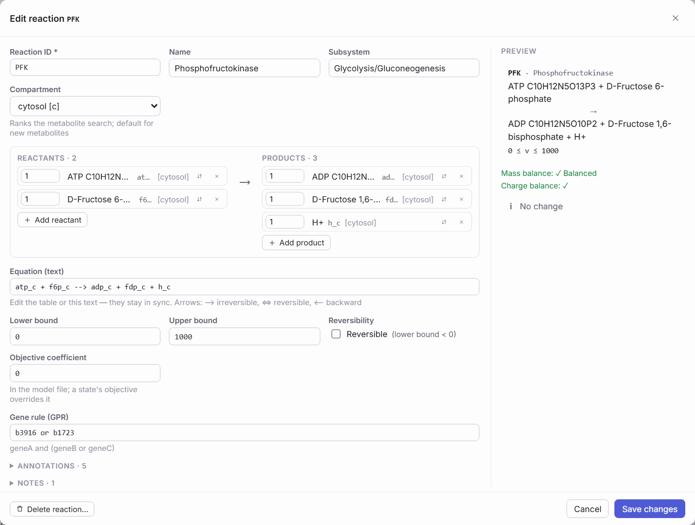

# Editing the model structure

[Model states](constraints.md#model-states) change *constraints*: bounds and the objective. Sometimes the model itself needs to change. A missing reaction, a wrong gene–reaction rule, a metabolite in the wrong compartment, or an exchange reaction a new medium needs. The **structural editor** makes these changes on the working COBRApy model, with validation before each change and undo after it.

!!! note "Edits are a layer, not an overwrite"
    Structural edits are logged per model and re-applied whenever that model file is loaded again. The imported file is never modified. Exported models and simulation results record the edits they include: results computed on an edited model carry the number and a hash of the edits in their provenance.

## Edit or create a reaction

Open the editor with *Edit reaction* in a reaction's inspector, *+ Reaction* in the Explorer toolbar, or *New reaction with it* from a metabolite.

<figure class="gm-shot gm-medium" markdown>

<figcaption markdown="span">The reaction editor (here for `PFK`, closed again without changes). The stoichiometry table and the text equation stay in sync; mass and charge balance are checked live.</figcaption>
</figure>

The editor covers the reaction **ID**, **name**, **bounds**, **reversibility**, **objective coefficient**, **subsystem**, **gene–reaction rule**, **annotations** and **notes**, and the **stoichiometry**, edited either as a *Reactants | Products* table or as a text equation. It shows:

- a **preview** of the equation;
- **mass and charge balance**, products minus reactants. Unbalanced reactions can still be saved, because biomass, lumped and pseudo-reactions are unbalanced by design; a balance that cannot be evaluated (missing formula or charge) says which metabolite is responsible;
- a warning for a **potential duplicate** of an existing reaction, with a link to it;
- suggested IDs that follow the model's own naming convention.

## Add a metabolite

*+ Metabolite* (Explorer), or adding a participant in the reaction editor, opens a search that looks in three places, in this order:

1. **In this model**: the compound may already exist, in another compartment or under another name.
2. **Databases**: KEGG and ChEBI resolved through MetaNetX, plus the local BiGG tables if installed. Type a name or an identifier (`C00149`, `CHEBI:30797`, `MNXM98`, `cpd00130`). Low-confidence matches must be confirmed (*I checked the identity: this is …*).
3. **By hand**: ID, name, formula, charge, compartment. A new compartment can be created in the same step.

New metabolites and compartments are created in the same transaction as the reaction that uses them, so an edit is either applied completely or not at all.

## Exchange, sink and demand reactions in one step

From a metabolite's inspector (*Boundary ▾*) or its right-click menu, *Create Exchange*, *Create Sink* or *Create Demand* adds the boundary reaction with sensible bound presets:

| Type | Meaning | Default |
| --- | --- | --- |
| Exchange | Exchange with the environment | No uptake unless you choose it |
| Sink | Artificial supply or removal | As chosen in the dialog |
| Demand | Irreversible removal | Irreversible |

The dialog detects an existing boundary reaction for the same metabolite and offers to open it instead of creating a duplicate. It also warns when an exchange is created for a metabolite that is not extracellular.

## Validation, undo and history

- **Before every change** the backend validates it: duplicate IDs, unknown metabolites or compartments, invalid coefficients, bounds or gene rules. A rejected edit leaves the model unchanged; a failed edit is rolled back.
- **Undo / redo** (++ctrl+z++ / ++ctrl+shift+z++) walks back structural edits and state changes in the order they were made.
- The **Structure** button in the top bar lists the edit history and offers *Validate model* (duplicates and other issues, each linked to the Explorer), *Export model…*, *Export patch* and *Discard all*.
- **Export patch** writes `model_patch.json`: the edits and their net effect (added, removed, changed), to document or reproduce them.
- When you leave a model with unsaved edits, GEMsMAP asks whether to export the model, keep the edits for later (they stay in the backend and are re-applied next time) or discard them.

Edits change the real `cobra.Model` used by FBA, FVA, the medium and exports, so a new simulation immediately reflects them.

**Next:** [Run constraint-based analyses](constraint-based-analysis.md) on the edited model.

