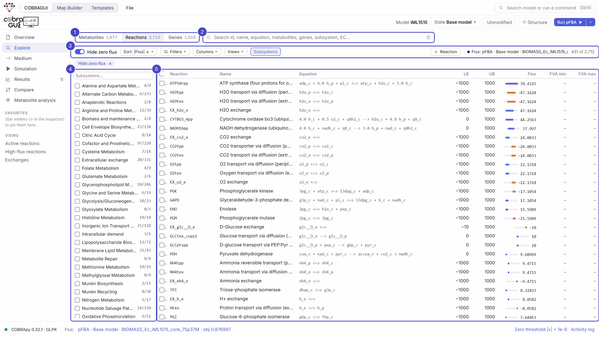

# Exploring a model

A genome-scale model is too large to read as a list. The **Explore** section turns it into three searchable tables (metabolites, reactions, genes), and the **inspector** on the right shows any entity you click, with links to everything it is connected to. Walking from a reaction to one of its metabolites, to another reaction, and back is the main way to understand a part of the network.

<figure class="gm-shot" markdown>

<figcaption markdown="span">The built-in view *Active reactions* after pFBA on iML1515: zero-flux reactions hidden, sorted by |flux|. 431 of 2,712 reactions carry flux in this solution.</figcaption>
</figure>

<ol class="gm-callouts" markdown>
<li><strong>Tables</strong>: Metabolites, Reactions, Genes, with their sizes (keys <kbd>M</kbd>, <kbd>R</kbd>, <kbd>G</kbd>).</li>
<li><strong>Search</strong> (key <kbd>F</kbd>): ranked, across many fields at once.</li>
<li><strong>Toolbar</strong>: <em>Hide zero flux</em>, sort, filters, columns, saved views, the subsystem browser and <em>+ Reaction</em> / <em>+ Metabolite</em>.</li>
<li><strong>Subsystem browser</strong>: active / total reactions per subsystem; a click filters the table.</li>
<li><strong>Table</strong>: virtualised, so it stays fast with thousands of rows. Click a row to inspect it, tick rows to act on them.</li>
</ol>

## Search

The search box looks in several fields at once and ranks the matches:

| Table | Fields searched |
| --- | --- |
| Reactions | ID, name, equation, participant names, genes, subsystem, EC numbers, annotations |
| Metabolites | ID, name, formula, compartment, annotations |
| Genes | ID, name, associated reactions |

For example, `phosphofructokinase` finds `PFK`, `PFK_2` and `PFK_3` in iML1515. ++ctrl+k++ opens the command palette, which searches the whole model at once and also runs commands such as *Configure medium*, *Duplicate current state* or *Visualize active result on map*.

## Filter, sort and save views

- **Hide zero flux** (reactions), **Hide zero turnover** (metabolites) and **Only genes with active reactions** need an active result. "Zero" means below the [zero threshold](constraint-based-analysis.md#solver-and-numerical-zero) of the status bar. With only an FVA result, the reaction toggle becomes *Hide blocked (FVA)*.
- **Filters** (reactions): |flux| above or below a value; reversible, irreversible or blocked; modified bounds only; reaction type (*only* or *hide* internal, transport, exchange, demand, sink); with or without gene association; favorites; compartment; subsystem. Active filters appear as removable chips under the toolbar.
- **Sort**: |flux|, flux, FVA width, ID, name, bounds or subsystem. Clicking the *Flux* column header twice sorts by |flux|.
- **Columns**: reaction, name, equation, LB, UB, flux, FVA min/max/range, subsystem, type, reversible, genes, EC, objective coefficient.
- **Views** store a search with its filters and sort. Five are built in (*Active reactions*, *High-flux reactions* with |flux| > 1, *Exchanges*, *Transport*, *Modified bounds*); *Save current search & filters* adds your own. They are kept per model.

## Act on a selection

Tick rows (the header checkbox selects every row shown) to open the action bar:

| Reactions | Metabolites |
| --- | --- |
| *Add to Map* · *Block…* · *Reset bounds* · *FVA on selection* · *Filter to selection* · *Export CSV* · Σ\|flux\| of the selection | *Add to Map* · *Connected reactions* · *Export CSV* |

Right-clicking a row, a chip or a node of the local network opens the same actions for that entity: inspect, add to map, edit, set as objective, block, copy ID/name/equation/formula, create an exchange, sink or demand, add to favorites.

## The inspector

Click any metabolite, reaction, gene or subsystem, in a table, an equation, a GPR rule, a search result or the local network, to open it in the inspector. ++alt+left++ / ++alt+right++ (or the arrows) move back and forward; the breadcrumbs show the path. Sections fold with a click on their title (*Expand all* / *Collapse all* at the top), and the ☆ star pins an entity to **Favorites** in the sidebar.

<figure class="gm-shot gm-narrow" markdown>

<figcaption markdown="span">Reaction inspector for `PFK` after pFBA on iML1515.</figcaption>
</figure>

**A reaction** shows:

- its **equation**, with metabolite names or IDs; every metabolite is a link;
- the **flux** in the active result, in mmol gDW⁻¹ h⁻¹, and the **FVA interval** and width if an FVA result is active (a note says when the values come from a result of another state);
- the **bounds editor** for the active state (see [Medium, bounds and objective](constraints.md#reaction-bounds)), with *Block*, *Allow reversible* and *Reset original*;
- objective coefficient, subsystem (a link), compartments and EC numbers;
- **reactants and products** with their coefficients;
- the **gene–reaction rule**, with each gene as a link and `AND`/`OR` highlighted;
- a **local network** (1 or 2 hops) and the raw **annotations**;
- actions: *Add to map*, *Focus in map* (when it is drawn), *Set as objective*, *Copy*, *Edit reaction*, *Duplicate…*, *Delete reaction…*.

**A metabolite** shows its formula, charge, compartment, turnover, and the reactions that produce and consume it. This view is the core of [metabolite analysis](metabolite-analysis.md).

**A gene** lists its reactions, how many are active in the current result, and their rules. Gene knockout simulation is not implemented yet; the inspector suggests blocking the associated reactions to explore an essentiality hypothesis by hand.

**A subsystem** shows its reactions, metabolites and genes, with *Add subsystem to map*, *Filter table*, *Select reactions* and *FVA on subsystem*.

### The local network

The small network at the bottom of the inspector is a **navigation aid, not a pathway map**. Around a metabolite, producing reactions are drawn on the left and consuming ones on the right: by the sign of the actual flux when a result is active, otherwise by the side of the equation. Around a reaction, substrates are on the left and products on the right. *2 hops* adds the neighbours' other reactions; a column holds at most nine nodes. Currency metabolites (ATP, NAD(P)H, H₂O, H⁺, phosphate, CoA, …) are hidden unless *cofactors* is ticked. Click any node to move there.

**Next:** change the [medium, bounds and objective](constraints.md), or go deeper into [metabolite analysis](metabolite-analysis.md).

