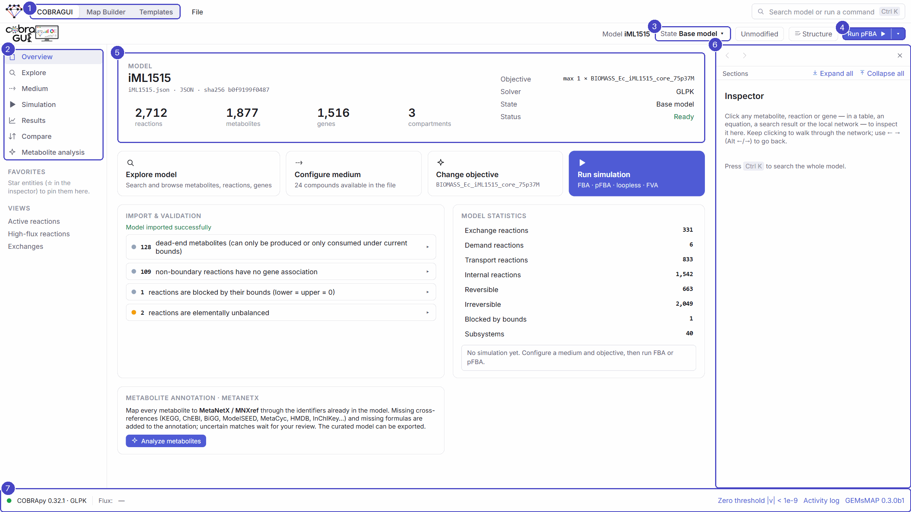
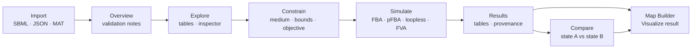

# COBRAGUI

{ .gm-section-logo }
{ .gm-section-logo }

**COBRAGUI** (COBRA graphical user interface) is the workspace of GEMsMAP that works on the model itself: a graphical front end to [COBRApy](https://opencobra.github.io/cobrapy/), the Python package for constraint-based reconstruction and analysis. It lets you load a genome-scale model, look inside it, change its constraints, simulate it and compare results by pointing and clicking. The computations are the standard COBRApy ones, run by a local Python service.

<figure class="gm-shot" markdown>

<figcaption markdown="span">COBRAGUI after importing *E. coli* iML1515 (BiGG): 2,712 reactions, 1,877 metabolites, 1,516 genes, 3 compartments. Validation notes (dead ends, reactions without gene association, blocked or unbalanced reactions) are listed on the overview and link to the entities involved.</figcaption>
</figure>

<ol class="gm-callouts" markdown>
<li><strong>Workspace switcher</strong>: COBRAGUI, Map Builder, Templates.</li>
<li><strong>Sections</strong> of COBRAGUI, in the order of a typical analysis: Overview, Explore, Medium, Simulation, Results, Compare, Metabolite analysis.</li>
<li><strong>Model state</strong>: the scenario whose bounds and objective are used (here the unmodified <em>Base model</em>). <em>Unmodified</em> / <em>Modified · n</em> shows its changes; <em>Structure</em> opens the history of structural edits.</li>
<li><strong>Run</strong> the selected method on the active state; the arrow chooses another method.</li>
<li><strong>Model card</strong>: file, format, checksum, size, objective, solver.</li>
<li><strong>Inspector</strong>: details of whatever you click (metabolite, reaction, gene, subsystem), with back/forward navigation.</li>
<li><strong>Status bar</strong>: backend and solver, the active flux and FVA results, the numerical zero threshold and the activity log.</li>
</ol>

## Why a graphical interface for COBRApy?

COBRApy is powerful but code-first: inspecting a reaction, changing an uptake rate or comparing two solutions each means writing and re-running code, and the context of a result (which medium, which bounds?) is easily lost. COBRAGUI keeps that context attached to every result and makes the model itself browsable. You can click a metabolite in an equation, see which reactions produce and consume it, and continue to the next one. Nothing replaces COBRApy: the interface sends requests, COBRApy computes, and the answers come back with their provenance.

## A typical session

1. [**Import a model**](importing-models.md) and read the validation notes on the overview.
2. [**Explore**](exploring-models.md) metabolites, reactions, genes and subsystems; every entity opens in the inspector.
3. [**Set the constraints**](constraints.md): medium, reaction bounds and objective, kept in named *model states*. If needed, [**edit the model structure**](editing-models.md).
4. [**Simulate**](constraint-based-analysis.md) with FBA, pFBA, loopless FBA or FVA.
5. Follow [**individual metabolites**](metabolite-analysis.md) through the solution, and curate their identifiers with MetaNetX.
6. [**Keep, compare and export results**](results-and-export.md), or send them to the Map Builder.

## What is kept, and where

| What | Where | Lifetime |
| --- | --- | --- |
| The imported model file | Backend cache (a copy) | Until you delete the cache. The original file is never modified. |
| Model states, results, favorites, saved views, medium presets | Browser (IndexedDB), per model checksum | Restored when the same model file is imported again. |
| Structural edits and metabolite curation | Backend cache, as logs next to the model | Re-applied whenever that model is loaded. |
| Exported models and results | Files you save | Permanent; they record the state, edits and curation they include. |

Because sessions are keyed by the model's checksum, importing a different version of a model starts a new session.

## Keyboard

| Keys | Action |
| --- | --- |
| ++ctrl+k++ or ++slash++ | Search the model or run a command |
| ++f++ | Focus the table search (Explore) |
| ++r++ / ++m++ / ++g++ | Reactions / Metabolites / Genes tab |
| ++alt+left++ / ++alt+right++ | Inspector back / forward |
| ++ctrl+z++ / ++ctrl+shift+z++ | Undo / redo a model change |
| ++ctrl+enter++ | Run the selected method |
| ++i++ | Show or hide the inspector |
| ++alt+1++ … ++alt+6++ | Overview, Explore, Medium, Simulation, Results, Compare |

**Start here:** [Importing models](importing-models.md).

