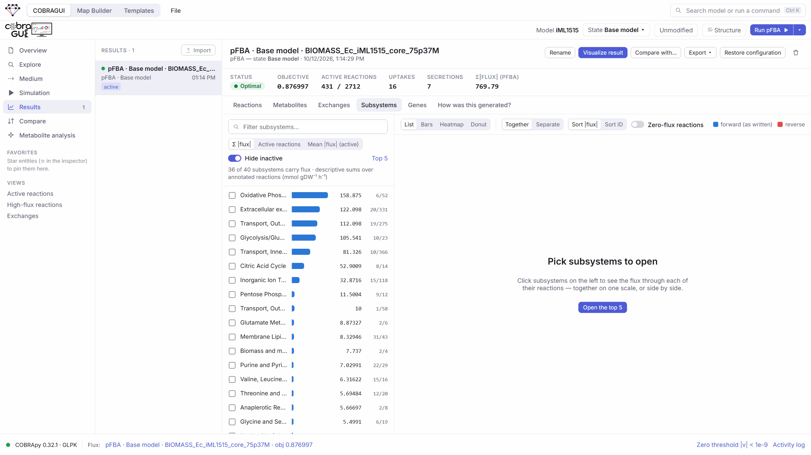

# Results, comparison and export

Every simulation is kept as a **result** with its full configuration. Results can be browsed, compared with each other, summarised by subsystem, exported, and sent to the Map Builder.

## The result history

The **Results** section lists every run, newest first, with its status, method, state and time. Tags mark the *active* flux and FVA results (the ones the Explorer and inspector display), imported results, results computed with another model, and FVA runs stopped early.

<figure class="gm-shot" markdown>

<figcaption markdown="span">A pFBA result of iML1515, *Exchanges* tab: what the solution takes up and secretes, in mmol gDW⁻¹ h⁻¹.</figcaption>
</figure>

<ol class="gm-callouts" markdown>
<li><strong>Result list</strong>, with <em>Import</em> for result files.</li>
<li><strong>Actions</strong>: rename (or double-click the title), <em>Visualize result</em>, <em>Compare with…</em>, <em>Export</em>, <em>Restore configuration</em> (a new state with exactly this configuration), delete.</li>
<li><strong>Summary</strong>: status, objective value, active reactions, number of uptakes and secretions, Σ|flux| for pFBA.</li>
<li><strong>Views</strong> of the result.</li>
</ol>

| Tab | Content |
| --- | --- |
| Reactions | Flux per reaction with the bounds used for this result (FVA: minimum, maximum, range and a range bar; flux sampling: mean, median, SD, 95 % interval and a box plot, with the histogram of the selected reaction). Searchable, *Hide zero flux*, sortable by \|flux\|. |
| Metabolites | [Turnover](metabolite-analysis.md#turnover-what-it-is-and-what-it-is-not) per metabolite. Not available for FVA or flux sampling. |
| Exchanges | Uptake and secretion per boundary reaction. Uptake is the flux that brings the metabolite into the system, whatever the sign convention of the reaction. For FVA: flux range and maximum uptake and secretion. For flux sampling: from the mean flux vector of the samples. |
| Subsystems | Subsystem summaries and figures (below). Only for models with subsystem annotations, and not for flux sampling. |
| Genes | Genes with the number of their reactions that carry flux. Not for flux sampling. |
| How was this generated? | The provenance record. |

### Provenance

<figure class="gm-shot gm-medium" markdown>

<figcaption>Everything needed to reproduce the result is stored with it.</figcaption>
</figure>

Each result records the model (name, file name, SHA-256 checksum, format), the state, the method and its parameters, the objective and whether it came from the file, the medium, every bound that differs from the file (original → current), structural edits if any, solver name and raw status, solver message, objective value, pFBA total flux, timestamp, computation time and COBRApy version. Results live in the browser and are restored when the same model file is imported again.

## Subsystem views and publication figures

For models with subsystem annotations (such as iML1515, with 40 subsystems), *Results → Subsystems* ranks subsystems by Σ|flux|, number of active reactions and mean |flux|, and shows the signed flux of the reactions of the subsystems you open, together or as separate panels.

<figure class="gm-shot" markdown>

<figcaption>Subsystem overview of a pFBA result. Σ|flux| sums magnitudes over reactions; it is a measure of activity, not a share of a whole.</figcaption>
</figure>

*Bars*, *Heatmap* and *Donut* turn the selected subsystems (or their Σ|flux| totals) into a journal-sized figure, with several results side by side, saved as **SVG**, **PDF** or **PNG at 300 or 600 dpi**. The interactive list avoids pie charts, because Σ|flux| values are not parts of a whole; the donut figure is offered only for the selected items and is captioned as a share of Σ|flux|.

## Comparing two results

The **Compare** section compares any two optimal results directly; nothing needs to be exported. **A** is the reference and **B** is compared against it.

<figure class="gm-shot" markdown>

<figcaption markdown="span">iML1515, pFBA, aerobic (A) versus no oxygen uptake (B). The growth rate drops from 0.876997 to 0.15754 h⁻¹.</figcaption>
</figure>

<ol class="gm-callouts" markdown>
<li>Choose A and B, the metric (Δ, |Δ|, log₂ fold change or fold change) and an optional pseudocount.</li>
<li><strong>Configuration differences first</strong>: medium, bounds, objective, method, and a warning if the two results come from different model files.</li>
<li>Objective A → B and how many reactions fall in each category; <em>Visualize comparison</em> sends it to the map.</li>
<li>Tables for reactions, metabolite turnover, exchanges and subsystems.</li>
</ol>

**Rows are classified before any ratio is taken.** Fold changes compare magnitudes, \(|B|/|A|\), and are only meaningful when both values are non-zero and have the same sign:

| Category | Rule (zero = below the zero threshold) | Fold change |
| --- | --- | --- |
| Changed / Unchanged | Both non-zero, same direction | \(\log_2(\lvert B\rvert/\lvert A\rvert)\) |
| Activated from zero | A is zero, B is not | none, unless a pseudocount is set |
| Inactivated to zero | B is zero, A is not | none, unless a pseudocount is set |
| Direction reversal | Opposite signs | **never** — the reaction runs the other way |
| Zero in both / Only in one result | — | none |

The **pseudocount** \(p\) is off by default. When set, it gives activated and inactivated rows \(\log_2((|B|+p)/(|A|+p))\), and those values are marked. Exchange rows also say whether a metabolite switched from uptake to secretion or vice versa.

**Flux sampling results** are not listed in Compare: a distribution per reaction is not one flux vector. Send two sampling runs to the Map Builder to see them as conditions side by side.

**FVA results** are compared with FVA results only. Their rows are classified as unchanged, narrowed, widened, shifted or disjoint intervals. Comparing an FVA result with a flux distribution is refused, because an interval per reaction is not one flux vector.

In the *Metabolite turnover* tab, clicking a metabolite explains which reactions changed its turnover; see [Metabolite analysis](metabolite-analysis.md#why-did-turnover-change-explaining-a-comparison). The *Subsystems* tab shows a dumbbell A → B per subsystem.

**Comparing states before simulating.** *Model states (configuration)* at the top of Compare lists how two states differ in medium, bounds and objective, without running anything.

## Export

| From | Formats | Contains |
| --- | --- | --- |
| A result (*Export ▾*) | JSON | The whole result with its metadata (format `cobragui-result`). |
| | CSV | Reaction fluxes, FVA intervals, metabolite turnover or exchanges. Each CSV starts with `#` lines naming the result, model and checksum, state, method, solver, status, objective and timestamp. |
| A flux sampling result | CSV | *All samples* in long format (`reaction,condition,flux`, the format the Map Builder reads as a samples dataset) or *per-reaction statistics* (mean, SD, median, 2.5/25/75/97.5 % percentiles, min, max). The JSON keeps the samples too. |
| Explorer selection | CSV | The selected reactions or metabolites with bounds and flux or turnover. |
| Subsystem figures | SVG, PDF, PNG 300/600 dpi | Journal-sized figure. |
| The model (*Save as model…*) | SBML, COBRA JSON, MATLAB | A new model file with the active state, edits and curation applied (see [Medium, bounds and objective](constraints.md#saving-the-modified-model)). |
| Model state | JSON | *Export modifications*: bounds, objective and the history of changes. |

## Importing results

*Results → Import* (or dropping files on COBRAGUI) reads results made elsewhere, so they can be compared and mapped like your own:

- JSON exported by GEMsMAP (one result or a list, including FVA and flux sampling results), JSON exported by the earlier GEM Explorer, or a plain `{reaction_id: flux}` object;
- CSV or TSV: `reaction,flux`; wide tables `reaction,A,B,…` (one result per numeric column); FVA tables with `minimum/maximum`, `min/max`, `lower/upper` or `<name>_min/<name>_max` columns. The `#` provenance lines of GEMsMAP's own CSV export restore the name, method and source model.

Values are taken as they are in the file; nothing is re-solved. Results are matched to the loaded model by reaction ID, and the result records how many IDs matched and whether it was computed with another model. When the IDs match, COBRApy derives metabolite turnover and exchanges from the imported fluxes using the loaded model's stoichiometry, and says so. An FVA file whose "fluxes" are midpoints is imported as intervals only.

## To the Map Builder

- **Visualize result** sends the result's values as a dataset (one condition per result) and suggests mappings: |flux| → arrow width, flux → arrow colour (|flux| on a sequential palette, or signed flux on a diverging one), optionally turnover → node size. Only data are sent; no reaction is drawn. Arrows already on the map bind by model ID.
- **Visualize comparison** maps log₂FC or Δ to a diverging colour and, optionally, |flux| in B to width. Reactions without a defined fold change (activations, inactivations, reversals) are drawn neutral.
- **Add to Map** (Explorer, inspector, right-click) draws reactions, metabolites, a subsystem or a selection, with an automatic layout. Reactions open the Map Builder as a light preview that follows the mouse; a click places them (++esc++ cancels), with new copies of their metabolites.
- FVA results travel as **ranges**, shown with range plots, never as midpoints.
- Flux sampling results travel as **samples**: arrow width and colour follow the mean flux, and density or box plots (right-click a reaction → *Add linked plot*) show each reaction's distribution.

See [Displaying and comparing results](../maps/displaying-and-comparing-results.md).

**Next:** [Maps](../maps/index.md), to turn results into a figure.

