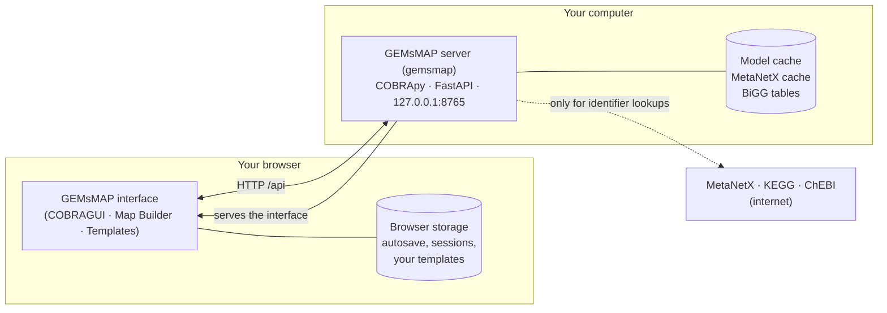

# Overview

GEMsMAP is a desktop-style web application for working with **genome-scale metabolic models** (GEMs). It runs on your own computer: one command, `gemsmap`, starts a local Python server that holds the models, runs [COBRApy](https://opencobra.github.io/cobrapy/) and serves the interface to your browser.

## Three workspaces

The switcher at the top left of the window moves between three workspaces. They share the same model and data.

| Workspace | In this documentation | What you do there |
| --- | --- | --- |
| **COBRAGUI** | [COBRAGUI](../cobra-gui/index.md) | Import, explore, edit and simulate a model; compare and export results. |
| **Map Builder** | [Maps](../maps/index.md) | Draw pathway figures, bind them to the model, map results onto them, export figures. |
| **Templates** | [Templates](../templates/index.md) | Design and review model-independent pathway templates and apply them to a model. |

Each workspace has its own logo at the left of the second row of the top bar, while the gem in the top left corner stays the mark of GEMsMAP. COBRAGUI stands for *COBRA graphical user interface*. It has its own logo and name because it is meant to grow into a front end for more of the COBRA ecosystem, while it ships inside GEMsMAP. In the source code it lives in `src/lab/` and `backend/cobragui/`.

## Where things run

- **All flux computations run in Python, on your computer.** The browser never computes fluxes. The backend listens on `127.0.0.1` only.
- **The Map Builder and the template matcher run in the browser.** Drawing maps and applying templates happen there; the server's COBRApy part is needed for COBRAGUI and for online identity searches.
- **Network access is limited to identifier services.** The metabolite analysis queries MetaNetX, and the template identity search queries KEGG and ChEBI (resolved through MetaNetX). Answers are cached locally. The BiGG tables are downloaded once with an explicit command and then used offline; GEMsMAP does not call the BiGG API.
- **Imported model files are copied to a local cache** (`%LOCALAPPDATA%\cobragui\models` on Windows, `~/.cache/cobragui/models` on macOS and Linux), so a restarted server reloads them. The original file is never modified.

## What you need to know first

You do not need to program to use GEMsMAP, but the analyses are standard constraint-based methods and their results only make sense with their assumptions in mind. If terms such as *flux*, *bounds* or *objective* are new, start with the [Glossary](../reference/glossary.md) and the explanation of [constraint-based analysis](../cobra-gui/constraint-based-analysis.md).

**Next:** [Install and start GEMsMAP](installation.md) · then take the [first look](first-look.md) at the window.

