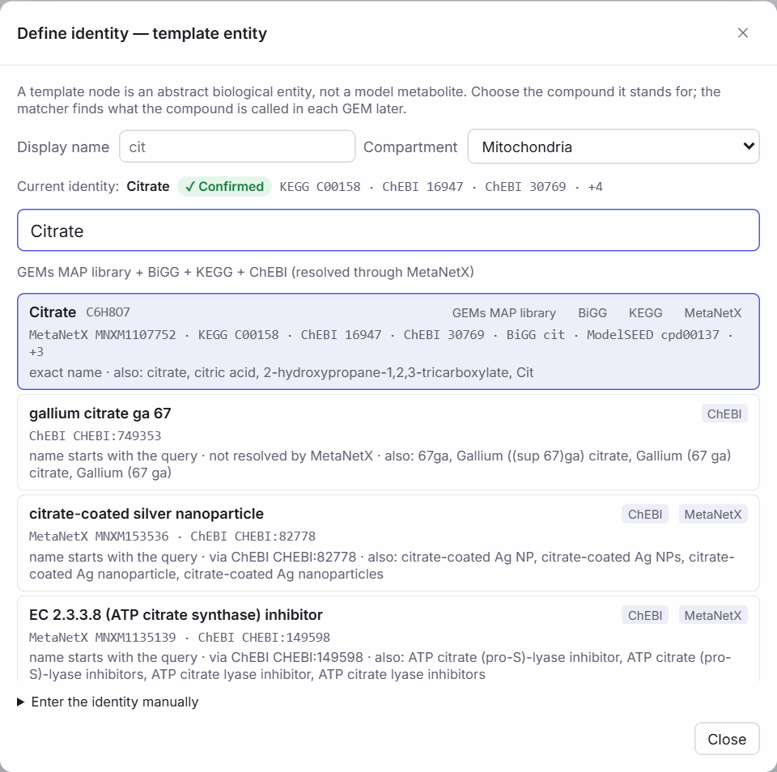
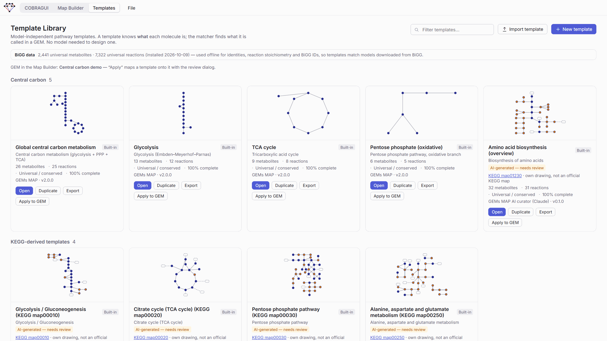

# The story of GEMsMAP

*By **Bruno Batista**, creator of GEMsMAP · [:fontawesome-brands-linkedin: LinkedIn](https://www.linkedin.com/in/bruno-batista-523856173/)*

## A problem: drawing the fluxes

I study *Aspergillus oryzae* for precision fermentation. I am building a genome-scale metabolic model (GEM) of this fungus to improve the production of recombinant proteins.

Along the way, I had a huge problem: how to represent the fluxes and draw the maps. I tried several well-known tools from the GEM world, such as [Escher](https://escher.github.io), [CNApy](https://github.com/cnapy-org/CNApy) and [Fluxer](https://fluxer.umbc.edu). They are good tools, used by many people, but I never felt comfortable with any of them for my work.

## A figure that changed the plan

Then I read the paper *Exploring CHO cell stability during prolonged passaging via eXplainable AI driven flux balance analysis* (Choi *et al.*, 2026). When I saw its [Figure 5](https://www.nature.com/articles/s41540-026-00660-z#Fig5), I thought: *maybe this is the best way to show metabolic fluxes.* The figure draws central carbon metabolism and methionine and cysteine metabolism as clean pathway maps, and next to the key reactions it plots the flux distribution of each culture passage (P10, P12, P26 and P28).

So I started to ask myself: how would I make this figure, but connected to the [COBRApy](https://opencobra.github.io/cobrapy/) world? That is how GEMsMAP was born. I added an intuitive graphical interface with a canvas-like drawing system: you draw a pathway as freely as in a drawing program, and each arrow knows which reaction of the model it represents.

<figure class="gm-shot" markdown>

<figcaption>The built-in central carbon example still carries this inspiration: flux distributions next to the reactions, and four conditions named after culture passages (P10, P12, P26, P28). The example data are illustrative.</figcaption>
</figure>

## Evolving by natural selection

From there, I kept using it and improving it, almost like an organism that develops by natural selection. Every real problem in my research was a new pressure, and the tool adapted to it.

## Templates: helping models talk to each other

Later, I realised that to be really useful to other people, GEMsMAP had to try to solve one of the main problems of the GEM field: **the conversation between different models**. The same metabolite can have a different ID in each model, so a map drawn for one model does not simply work with another.

At that time, [BiGG](https://bigg.bio) had recently made a huge change to its structure: it unified metabolites and reactions and linked them to reference databases (metabolites to ChEBI, reactions to Rhea). That gave me an idea: do the same with maps!

That is how **templates** were born. A template is a ready-made map in which each metabolite and reaction can (or not) have an **identity**. The system uses these identities to find and suggest the matching elements in your model, and then a person curates the options. See [Templates](templates/index.md) and [Identity and matching](templates/identity-and-matching.md).

<figure class="gm-shot" markdown>

<figcaption>Each metabolite of a template can carry an identity. The candidates come from the databases; a person confirms the right one.</figcaption>
</figure>

## From maps back to models

This idea worked so well that it became a way to analyse your model too. With the [metabolite analysis](cobra-gui/metabolite-analysis.md), you can link the metabolites of your model to databases such as [MetaNetX](https://www.metanetx.org) and BiGG in an easy way.

## AI: grab a coffee, then curate

In this age of AI, I noticed that AI could be very useful for creating templates. Because GEMsMAP is canvas-based, we can let an AI use the platform to build templates from images, from KEGG, and more. Go grab a coffee, then come back and curate everything!

!!! info "Where this stands today"
    The first templates drafted this way are already in the library: four KEGG-derived templates and the amino acid biosynthesis overview, drafted with an LLM (Claude) outside the application. They carry an *AI-generated — needs review* label until a person reviews them. GEMsMAP itself has no AI built in: you can ask any LLM (Claude, GPT, Codex…) to draw a template on its canvas format, then review it. See [Templates drafted with an LLM](templates/ai-assisted-templates.md).

<figure class="gm-shot" markdown>

<figcaption>The Template Library. The KEGG-derived templates were drafted with an LLM and stay marked for review until a person checks them.</figcaption>
</figure>

## Thank you

Since I started this project, I have learned a lot, and I am really happy with the result. More than anything, I hope this tool is useful to everyone who works with GEMs.

GEMsMAP is meant to be a **living project** that keeps evolving under the laws of natural selection. We are open to ideas and new features: if you have one, [send me a message on LinkedIn](https://www.linkedin.com/in/bruno-batista-523856173/). The [Roadmap](reference/roadmap.md) lists what is already planned.

Thank you for reading!

— Bruno Batista

## References

### Cited in this story

- **The CHO paper.** Choi D-H, Kim S-J, Song J, Park S-Y, Park C-H, Lee J, Lee D-Y (2026). Exploring CHO cell stability during prolonged passaging via eXplainable AI driven flux balance analysis. *npj Systems Biology and Applications* 12:36. [doi:10.1038/s41540-026-00660-z](https://doi.org/10.1038/s41540-026-00660-z)
- **[Escher](https://escher.github.io).** King ZA, Dräger A, Ebrahim A, Sonnenschein N, Lewis NE, Palsson BO (2015). Escher: a web application for building, sharing, and embedding data-rich visualizations of biological pathways. *PLoS Computational Biology* 11(8):e1004321. [doi:10.1371/journal.pcbi.1004321](https://doi.org/10.1371/journal.pcbi.1004321)
- **[CNApy](https://github.com/cnapy-org/CNApy).** Thiele S, von Kamp A, Bekiaris PS, Schneider P, Klamt S (2022). CNApy: a CellNetAnalyzer GUI in Python for analyzing and designing metabolic networks. *Bioinformatics* 38:1467–1469. [doi:10.1093/bioinformatics/btab828](https://doi.org/10.1093/bioinformatics/btab828)
- **[Fluxer](https://fluxer.umbc.edu).** Hari A, Lobo D (2020). Fluxer: a web application to compute, analyze and visualize genome-scale metabolic flux networks. *Nucleic Acids Research* 48(W1):W427–W435. [doi:10.1093/nar/gkaa409](https://doi.org/10.1093/nar/gkaa409)
- **[COBRApy](https://opencobra.github.io/cobrapy/).** Ebrahim A, Lerman JA, Palsson BO, Hyduke DR (2013). COBRApy: COnstraints-Based Reconstruction and Analysis for Python. *BMC Systems Biology* 7:74. [doi:10.1186/1752-0509-7-74](https://doi.org/10.1186/1752-0509-7-74)
- **[BiGG Models](https://bigg.bio).** King ZA, Lu J, Dräger A, *et al.* (2016). BiGG Models: a platform for integrating, standardizing and sharing genome-scale models. *Nucleic Acids Research* 44:D515–D522. [doi:10.1093/nar/gkv1049](https://doi.org/10.1093/nar/gkv1049). The universal components and the ChEBI and Rhea links of the new BiGG site are described on its [About page](https://bigg.bio/about).
- **[MetaNetX](https://www.metanetx.org).** Moretti S, Tran VDT, Mehl F, Ibberson M, Pagni M (2021). MetaNetX/MNXref: unified namespace for metabolites and biochemical reactions in the context of metabolic models. *Nucleic Acids Research* 49(D1):D570–D574. [doi:10.1093/nar/gkaa992](https://doi.org/10.1093/nar/gkaa992)
- **[KEGG](https://www.kegg.jp).** Kanehisa M, Goto S (2000). KEGG: Kyoto Encyclopedia of Genes and Genomes. *Nucleic Acids Research* 28(1):27–30. [doi:10.1093/nar/28.1.27](https://doi.org/10.1093/nar/28.1.27)

### Other tools worth knowing

The GEM community has built many tools to analyse and visualise metabolic networks. This list is far from complete; each tool has its own strengths.

| Tool | What it does | Reference |
| --- | --- | --- |
| [Escher-FBA](https://sbrg.github.io/escher-fba) | Runs FBA in the browser on Escher maps: change bounds, knock out reactions, change the objective. | Rowe E, Palsson BO, King ZA (2018). *BMC Systems Biology* 12:84. [doi:10.1186/s12918-018-0607-5](https://doi.org/10.1186/s12918-018-0607-5) |
| [Shu](https://biosustain.github.io/shu) | Plots multi-omics data on Escher-format maps, with several conditions and distributions instead of single values. | Carrasco Muriel J, Cowie N, Taylor Parkins S, Mansouvar M, Groves T, Nielsen LK (2024). *Bioinformatics* 40(3):btae140. [doi:10.1093/bioinformatics/btae140](https://doi.org/10.1093/bioinformatics/btae140) |
| MetExploreViz | A web component for interactive visualisation of metabolic networks, used in the MetExplore server. | Chazalviel M, *et al.* (2018). *Bioinformatics* 34(2):312–313. [doi:10.1093/bioinformatics/btx588](https://doi.org/10.1093/bioinformatics/btx588) |
| OptFlux | A desktop platform for metabolic engineering: phenotype simulation (FBA, MOMA, ROOM), strain optimisation, and results drawn over the network. | Rocha I, *et al.* (2010). *BMC Systems Biology* 4:45. [doi:10.1186/1752-0509-4-45](https://doi.org/10.1186/1752-0509-4-45) |
| [iPath3.0](https://pathways.embl.de) | Web tool to visualise and customise KEGG-based global metabolic maps. | Darzi Y, Letunic I, Bork P, Yamada T (2018). *Nucleic Acids Research* 46(W1):W510–W513. [doi:10.1093/nar/gky299](https://doi.org/10.1093/nar/gky299) |
| [Cytoscape](https://cytoscape.org) | General-purpose software for network visualisation and analysis, with many plugins. | Shannon P, *et al.* (2003). *Genome Research* 13:2498–2504. [doi:10.1101/gr.1239303](https://doi.org/10.1101/gr.1239303) |
