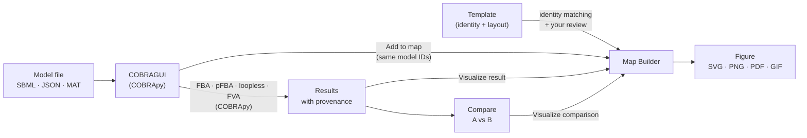

<h1 class="gm-hero__tagline">An Interactive Workbench for Genome-Scale Metabolic Models</h1>

GEMsMAP connects constraint-based computation, reaction and metabolite exploration, and editable metabolic maps in one application. Load a genome-scale model, simulate it with COBRApy, follow how individual metabolites participate in the network, and turn the results into a clear pathway figure, without writing every step as code.

[Get started](getting-started/index.md){ .md-button .md-button--primary }
[COBRAGUI](cobra-gui/index.md){ .md-button }
[Maps](maps/index.md){ .md-button }
[Templates](templates/index.md){ .md-button }

<figure class="gm-shot" markdown>

<figcaption>The built-in central carbon example in the Map Builder: arrow width and colour encode flux, each density plot shows a flux distribution per condition (P10, P12, P26, P28), and the bar at the bottom switches or animates conditions. The example data ship with the application and are illustrative.</figcaption>
</figure>

## Why GEMsMAP?

Genome-scale metabolic models (GEMs) describe thousands of reactions and metabolites. *Escherichia coli* iML1515, for example, has 2,712 reactions, 1,877 metabolites and 1,516 genes. Asking such a model a question is easy with COBRApy; **reading the answer** is harder. Flux vectors are long tables, identifiers differ between models, and the figures that communicate a result are usually redrawn by hand, outside the analysis.

GEMsMAP keeps these steps together. Every simulation result stays inspectable (which medium, objective, bounds and solver produced it), every metabolite and reaction can be followed through the network, and the same identifiers that COBRApy uses are carried onto the map, so results bind to the drawing without manual matching.

## Three parts, one workflow

-   :material-flask-outline:{ .lg .middle } **COBRAGUI**

    ---

    The COBRA graphical user interface: a front end to COBRApy. Import SBML, COBRA JSON or MATLAB models, configure the medium, bounds and objective, run FBA, pFBA, loopless FBA or FVA, then inspect, compare and export the results.

    [:octicons-arrow-right-24: COBRAGUI](cobra-gui/index.md)

-   :material-vector-polyline:{ .lg .middle } **Maps**

    ---

    The *Map Builder* workspace: an editable canvas for pathway figures. Draw or insert pathways, bind them to the model, map fluxes to arrow width and colour, compare conditions and export SVG, PNG, PDF or animated GIF.

    [:octicons-arrow-right-24: Maps](maps/index.md)

-   :material-shape-outline:{ .lg .middle } **Templates**

    ---

    The *Templates* workspace: reusable pathway layouts that describe **biological identity**, not model IDs. A matcher finds what each molecule is called in a given GEM and asks you to review uncertain cases.

    [:octicons-arrow-right-24: Templates](templates/index.md)

## How the parts fit together

The model is the shared reference: reactions drawn on a map keep their model IDs, so a result computed in COBRAGUI colours the arrows that represent those reactions.

## Design goals

- **Reproducibility.** Each result records the model checksum, model state, medium, objective, modified bounds, method parameters, solver, status and time. The imported model file is never modified.
- **Inspectability.** Analyses report their solver status explicitly; a failed solve never shows zeros as fluxes. Template matches show their evidence, and uncertain matches wait for a person.
- **Visual clarity.** A map is a communication device. Its layout is chosen by people (or a reviewed template) and stays stable when data or models change.

These are design goals, not guarantees: the biological meaning of a flux distribution still depends on the model, its constraints and the question asked. See [Limitations](reference/limitations.md).

## What is implemented today

| Area | Status |
| --- | --- |
| Model import (SBML, COBRA JSON, MATLAB), exploration, editing | Implemented |
| FBA, pFBA, loopless FBA, FVA (with progress and stop) | Implemented |
| Result history, comparison, subsystem views and figures | Implemented |
| Metabolite annotation curation with MetaNetX (and local BiGG tables) | Implemented |
| Map Builder, flux mapping, condition comparison, export | Implemented |
| Model-independent templates, identity matching and review | Implemented |
| KEGG-derived templates drafted with an LLM, outside the application | Awaiting review |
| Solver selection, flux sampling, gene knockouts | Planned |
| Community template hub | Planned |

The full list of planned work is on the [Roadmap](reference/roadmap.md).

## Acknowledgements

GEMsMAP builds on open science software and data. All simulations run in [COBRApy](https://opencobra.github.io/cobrapy/) (Ebrahim *et al.*, 2013, *BMC Systems Biology* 7:74). Identifier curation uses [MetaNetX/MNXref](https://www.metanetx.org) and, when installed locally, the universal tables of [BiGG Models](https://bigg.bio). The examples in this documentation use the *E. coli* model [iML1515](reference/examples.md) from BiGG. GEMsMAP is an independent project and is not maintained or endorsed by the COBRApy, BiGG, MetaNetX or KEGG teams.

Using GEMsMAP in your work? See [How to cite](reference/how-to-cite.md). Curious how it all started? Read [the story of GEMsMAP](history.md).
