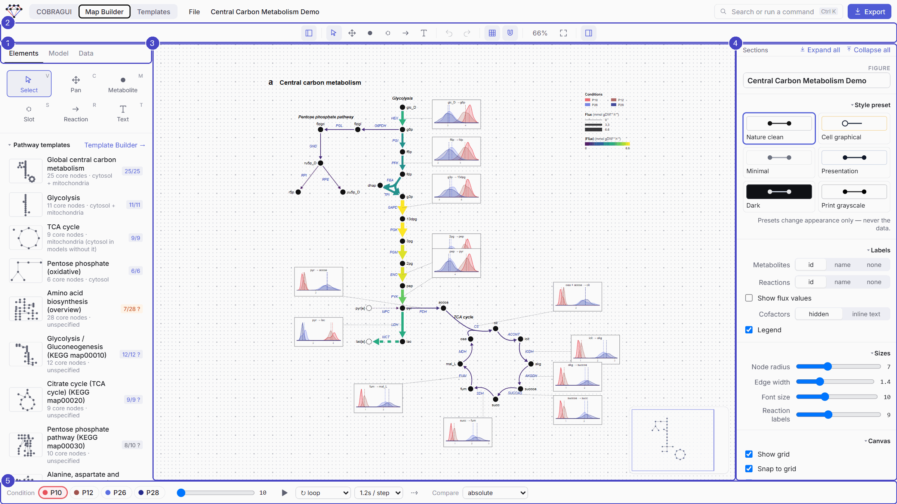
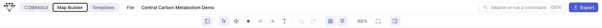
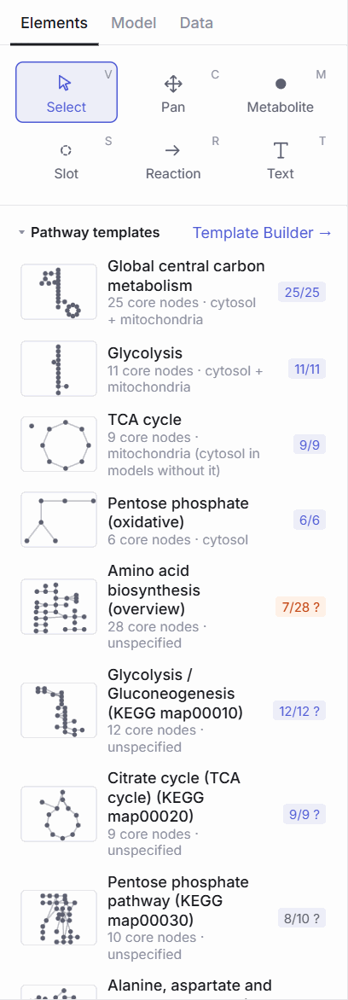

# Canvas and side panels

<figure class="gm-shot" markdown>

<figcaption>The Map Builder window, here with the built-in central carbon example.</figcaption>
</figure>

<ol class="gm-callouts" markdown>
<li><strong>Left panel</strong> with three tabs: <em>Elements</em>, <em>Model</em>, <em>Data</em> (<kbd>Alt</kbd>+<kbd>1</kbd>/<kbd>2</kbd>/<kbd>3</kbd>).</li>
<li><strong>Toolbar</strong>: panels, drawing tools, undo/redo, grid and snapping, zoom, fit.</li>
<li><strong>Canvas</strong>.</li>
<li><strong>Inspector</strong>: the selected item, or the whole figure.</li>
<li><strong>Condition bar</strong>: conditions, animation and comparison mode.</li>
</ol>

## Top bar and toolbar

The **top bar** holds the workspace switcher, the *File* menu, the editable figure name, the search / command palette (++ctrl+k++) and **Export**.

<figure class="gm-shot" markdown>

</figure>

| Tool | Key | Use |
| --- | --- | --- |
| Select | ++v++ | Click to select, drag to move, drag on empty canvas to box-select. |
| Pan | ++c++ | Drag to move the view. Also: hold ++space++ and drag, or drag with the right mouse button. |
| Metabolite | ++m++ | Click to place a metabolite node (search the model to bind it). |
| Slot | ++s++ | An empty placeholder node, bound later (see [Linking a map to a model](mapping-model-elements.md#slots-and-auto-bind)). |
| Reaction | ++r++ | Draw an arrow between nodes. |
| Text | ++t++ | Place a text label. |

Then come undo / redo (++ctrl+z++ / ++ctrl+shift+z++), **Show grid** and **Snap to grid** (independent of each other), the zoom level (click to reset to 100 %), **Fit all** (++f++; ++shift+f++ fits the selection) and the inspector toggle.

## Navigating

!!! tip "The recommended way: C to move, V to work, the wheel to zoom"
    Press ++c++ for the **hand** and drag to move around the map; press ++v++ to go back to **Select** and work on it; zoom with the **mouse wheel**, which zooms around the pointer. Switching between ++c++ and ++v++ all the time is the fastest and safest way to work: with the hand, a drag never moves or selects anything by accident.

- **Zoom** with the mouse wheel, ++plus++ / ++minus++, or the zoom buttons. On a trackpad, pinch to zoom.
- **Pan** with the hand tool (++c++), or hold ++space++ and drag, or drag with the right or middle mouse button (a right-click without moving still opens the context menu). On a trackpad, move two fingers; ++shift++ + wheel scrolls sideways.
- ++f++ fits the whole figure, ++shift+f++ the selection; click the zoom level to reset to 100 %.
- The **minimap** in the lower right corner shows the whole figure and the visible window.

## Selecting and moving

- Click to select; ++shift++-click adds to the selection; drag on empty canvas to box-select. ++ctrl+a++ selects everything.
- Drag to move. **Smart guides** snap to the alignment of nearby items (turn them off in the figure settings, or hold ++alt++ while dragging). ++shift++-drag constrains movement to 0°, 45° or 90°.
- Arrow keys nudge by 1 unit, ++shift++ + arrow by 10.
- ++l++ **locks** the selection: locked items are skipped by clicks and box selection, so a background or a finished part cannot move by accident. Hold the mouse on a locked item for 3 s, or right-click it, to unlock.
- ++ctrl+c++ / ++ctrl+v++ / ++ctrl+d++ copy, paste and duplicate; ++delete++ removes; ++ctrl+g++ groups the selection as a pathway, ++ctrl+shift+g++ ungroups.

A **floating toolbar** next to the selection offers the actions that fit it: bind a node to a model metabolite, expand one reaction upstream or downstream, add a linked plot, reverse an arrow, change its routing, find routes, collapse arrows, and, for several items, layouts and *Align & distribute* (see [Drawing pathways](drawing-pathways.md#layouts-alignment-and-tidying)).

## The left panel

<figure class="gm-shot gm-narrow" markdown>

<figcaption markdown="span">The *Elements* tab. With a model loaded, each pathway template shows its coverage of that model (for example `25/25`); a **?** means some matches still need review.</figcaption>
</figure>

| Tab | Contents |
| --- | --- |
| **Elements** | The drawing tools; **pathway templates** (built-in and yours, with coverage badges); *Template Builder →*; **shapes**; **My templates** saved from a selection; **annotations**: panel label, figure title, pathway label, compartment box. |
| **Model** | The bound GEM with its size and validation notes; a search over IDs, names, genes, EC numbers and pathways, with buttons to add a metabolite or a reaction (with its metabolites), focus a node or expand downstream; **Find metabolic path…**. |
| **Data** | Import of flux and other data; datasets; conditions (rename, recolour, reorder, set a time); **Map data → visual**: mappings from datasets to arrow width, colour, opacity or label and to node radius, fill or opacity; saved views. See [Displaying and comparing results](displaying-and-comparing-results.md). |

As in the inspector, the sections of these tabs (for example *Pathway templates* or *Shapes*) fold with a click on their title, and the panel remembers which ones are folded.

## The inspector

The right panel adapts to the selection. Its sections fold with a click on their title (*Expand all* / *Collapse all* at the top).

| Selection | What the inspector offers |
| --- | --- |
| Nothing | **Figure** settings: name, style preset, global label mode for metabolites and reactions (ID / name / none), *Show flux values*, cofactors hidden or as inline text, legend on/off, node radius, edge width, font sizes, grid, snapping, smart guides, layout spacing. |
| A metabolite | Model identity (*Inspect in COBRAGUI →*), template mapping and its candidates, formula, charge, compartment, values per condition, appearance (label, label position, radius, style, fill, lock), **connected reactions** with *Hide zero-flux reactions*, *Upstream* / *Downstream*. |
| A reaction | Model identity and equation, **participants shown** on this arrow, flux in the active condition and in every condition, FVA ranges, bounds, genes, subsystem, EC, appearance (label, routing straight / curved / orthogonal, curvature, solid or dashed line, *Reverse*, *Flip label*), **Routes**, **Linked plots**. |
| A plot, text, group or the legend | Their own properties: plot type, dataset, size; text, size, weight, colour; group title, kind, background, border, padding; legend size. |
| Several items | Layouts, circle options, *Tidy selection*, *Collapse into one arrow*, label settings for all selected metabolites, routing for all selected reactions, *+ density plot for each*. |

<figure class="gm-shot" markdown>

<figcaption markdown="span">A reaction on the map (`PFK`): its participants, its flux in each condition and its appearance.</figcaption>
</figure>

<figure class="gm-shot" markdown>

<figcaption markdown="span">A metabolite on the map (`pyr_c`): template mapping with its alternatives, data and connected reactions.</figcaption>
</figure>

## Context menu and command palette

**Right-click** on the canvas or on an item for the actions of that place or item: add a metabolite, slot, text or panel label here; expand the network upstream (1 or 2 steps) or downstream (1, 2 or 5 steps); bind, rebind, confirm or clear a mapping; find a path or routes; change routing, flip a label, reverse an arrow; add a linked plot; group, lock, collapse; *Save as template…*; duplicate, paste, delete.

++ctrl+k++ opens the **command palette**: type to find a command (create, layout, labels, style, condition, file, template, view) or an element of the model to add.

## All shortcuts

Press ++question++ in the Map Builder for the list.

| Keys | Action |
| --- | --- |
| ++v++ ++c++ ++m++ ++s++ ++r++ ++t++ | Select, pan, metabolite, slot, reaction, text |
| ++space++ + drag, right-drag | Pan |
| ++p++ | Add a density plot to the selected reaction(s) |
| ++ctrl+k++ | Command palette |
| ++ctrl+z++ / ++ctrl+shift+z++ | Undo / redo |
| ++ctrl+c++ / ++ctrl+v++ / ++ctrl+d++ | Copy / paste / duplicate |
| ++ctrl+g++ / ++ctrl+shift+g++ | Group as pathway / ungroup |
| ++ctrl+a++ | Select all |
| ++delete++ | Delete |
| ++l++ | Lock the selection |
| Arrows (+ ++shift++) | Nudge by 1 (10) units |
| ++shift++ + drag | Constrain to 0°, 45°, 90° |
| ++alt++ + drag | Ignore smart guides |
| ++f++ / ++shift+f++ | Fit all / fit selection |
| ++bracket-left++ / ++bracket-right++ | Previous / next condition |
| ++ctrl+s++ / ++ctrl+o++ / ++ctrl+e++ | Save project / open project / export figure |
| Double-click canvas | Add a metabolite |
| Drag a node's outer ring | Draw a reaction (drop on empty canvas: new slot) |
| Double-click a label | Edit the text |

**Next:** [Drawing pathways](drawing-pathways.md).

