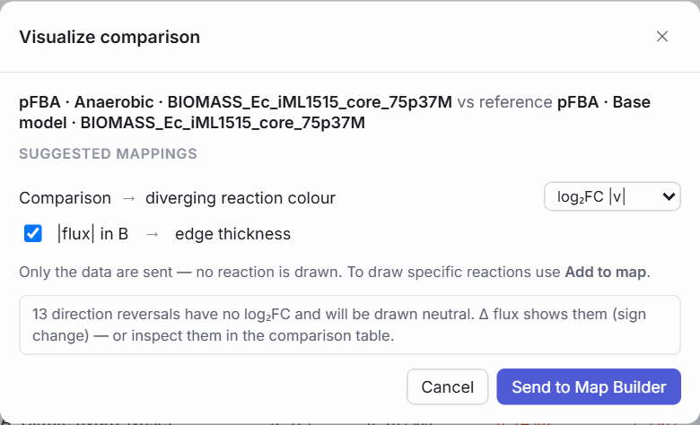
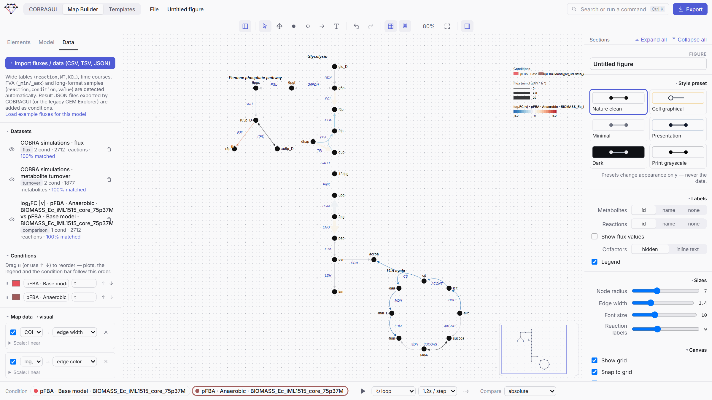

# Displaying and comparing results

Data reach a map as **datasets**. A dataset holds one or more **conditions** (columns) of values for reactions or metabolites. **Mappings** turn those values into visual properties: arrow width and colour, node size and fill. The model IDs bound to the drawing decide which value goes where.

## Getting data onto the map

**From COBRAGUI.** *Visualize result* and *Visualize comparison* send results as datasets (see [Results, comparison and export](../cobra-gui/results-and-export.md#to-the-map-builder)). Each result becomes a condition of the shared *COBRA simulations* datasets: fluxes, metabolite turnover, and FVA intervals as ranges.

<figure class="gm-shot" markdown>

<figcaption>Sending a result: only data travel, and mappings are suggested.</figcaption>
</figure>

<figure class="gm-shot" markdown>

<figcaption>Sending a comparison: log₂FC or Δ on a diverging colour scale.</figcaption>
</figure>

**From a file** (*Data → Import fluxes / data*, or drop the file on the window):

| Shape | Example header | Becomes |
| --- | --- | --- |
| Wide table | `reaction,WT,KO1,KO2` | One condition per numeric column (fluxes, metabolite values or a time course) |
| FVA table | `reaction,WT_min,WT_max` or `reaction,min,max` | Ranges, one condition per prefix |
| Long format | `reaction,condition,value` (repeated rows) | Samples per condition, for distributions such as flux sampling or replicates |
| Result JSON | exported by COBRAGUI | Conditions of the COBRA datasets |

CSV, TSV and semicolon-separated files are recognised, and lines starting with `#` are ignored. A first column called *metabolite*, *compound* or *species* makes a metabolite dataset; otherwise GEMs MAP decides by which IDs match the model. IDs are matched to the model leniently: case is ignored, and compartment suffixes and `M_`/`R_` prefixes are tolerated. The dataset shows how many IDs matched (*n % matched*). Clicking it opens the import report, where each unmatched ID can be mapped to a model ID by hand; if almost nothing matches, the report says the file was probably made for a different model.

!!! note "Sampling data"
    GEMs MAP does not run flux sampling ([planned](../reference/roadmap.md)), but it displays sampling results made elsewhere: import them in long format and add density or box plots. The built-in example uses such sampled distributions.

## Datasets and conditions

The *Data* tab lists datasets with their kind (`flux`, `fva`, `samples`, `turnover`, `metabolite`, `comparison`), size and match rate; each can be hidden, renamed or removed. **Concentrations and turnover are different kinds and are never mixed.** A turnover mapping is never silently replaced by a concentration mapping or vice versa.

**Conditions** have a name, a colour and optionally a time. Drag ⋮⋮ (or use ↑ ↓) to reorder them; plots, the legend, the condition bar and GIF export follow this order.

<figure class="gm-shot gm-narrow" markdown>

<figcaption markdown="span">The *Data* tab with two pFBA results and their comparison.</figcaption>
</figure>

## Mapping data to visual properties

Under **Map data → visual**, each mapping connects a dataset to a property:

| Target | Properties |
| --- | --- |
| Reactions (arrows) | width, colour, opacity, label (the value as text) |
| Metabolites (nodes) | radius, fill, opacity |

Each mapping has a **scale** (linear, square root, log or percentile), an optional manual **domain** (min / max), and for colours a **palette**:

| Palette | Kind |
| --- | --- |
| Viridis, Plasma, Blues, Reds, Grayscale | Sequential, for magnitudes |
| Blue–Red, Cool–Warm, Purple–Orange, Green–Purple | Diverging, for signed values and comparisons |

All built-in palettes are chosen to be colour-blind safe.

**How fluxes are drawn.**

- **Direction** always follows the sign of the flux in the active condition: the arrowhead points the way the reaction runs. A reaction that runs backwards flips its arrowhead; nothing about the drawing has to change.
- Because direction is already encoded, flux **colour defaults to |flux|** on a sequential palette (Viridis). Tick *signed* to colour by the signed value on a diverging palette.
- **Width** scales |flux| between 0.5× and 7× the base edge width.
- **Zero flux** (|v| < 10⁻⁹) is drawn thin and grey, without an arrowhead.
- **Domains are computed across all conditions**, so switching condition never silently rescales the map: the same width means the same flux in every condition.

## Comparing conditions

The bottom bar selects the **active condition** (click a chip, or ++bracket-left++ / ++bracket-right++) and the **comparison mode**:

| Mode | Value shown |
| --- | --- |
| absolute | The value in the active condition |
| difference (Δ) | Active − reference |
| fold change | Active / reference |
| log₂ fold change | log₂(active / reference) |

In the comparison modes you choose the reference condition, and colours switch to a diverging palette centred on "no change". For fold changes of fluxes between two simulation results, COBRAGUI's *Visualize comparison* is preferable, because it classifies activations, inactivations and direction reversals before taking any ratio; reactions without a defined fold change are drawn neutral.

<figure class="gm-shot" markdown>

<figcaption markdown="span">iML1515, pFBA, anaerobic versus aerobic: colour = log₂FC of |flux| (blue lower, red higher), width = |flux| without oxygen.</figcaption>
</figure>

**Saved views** (*Data* tab) store the active condition, comparison mode, reference and mappings under a name, to switch quickly between versions of a figure.

## Mini-plots next to reactions

Select reactions and press ++p++, or use *Linked plots* in the inspector or the right-click menu, to attach **mini-plots** that move with their reaction:

| Plot | Shows | Typical data |
| --- | --- | --- |
| density | Distribution per condition (dashed line at the mean) | Samples |
| box | Distribution summary per condition | Samples |
| bar | One bar per condition | Fluxes |
| line | Values along conditions or time | Time courses |
| heatmap | One cell per condition | Fluxes, comparisons |
| range | Interval per condition | FVA results |

The plot inspector sets the type, dataset, title, font size and size; drag the handles to resize.

## Legend and animation

- The **legend** is generated from the active mappings (widths, colour scales, conditions) and can be resized by dragging a corner; *Legend* in the figure settings shows or hides it.
- ▶ in the bottom bar **plays through the conditions**: loop, ping-pong or once, at 0.5–3 s per step. With more than two conditions that all have a time, a timeline slider appears.
- **Flux particles** (the dots button) animate flow along arrows for presentations; they are not exported.
- For an animation file, see [GIF export](saving-and-exporting.md#animated-gif).

**Next:** [Save and export](saving-and-exporting.md) the figure.

