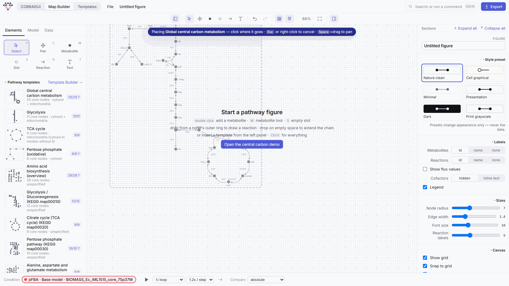

# Linking a map to a model

A drawing becomes scientifically useful when its nodes and arrows are **bound** to the metabolites and reactions of a genome-scale model. Bound elements show model details in the inspector, follow the model when data arrive, and can be inspected in COBRAGUI. This page explains where the map's model comes from, how binding works, and how pathway templates are mapped onto a model with your review.

## Where the map's model comes from

| Source | How | Notes |
| --- | --- | --- |
| **COBRAGUI** | Happens automatically the first time you *Add to map*, *Visualize result* or *Visualize comparison*. | The same model, with the same IDs. If the map already uses a different model, GEMsMAP asks before replacing it. If 97 % or more of the reaction IDs are shared (for example a newer version of the same model), the map keeps its copy and its bindings. |
| **File → Import GEM into the map only** | COBRA JSON or SBML, parsed in the browser. | Enough to draw, bind and display data, without the backend. *Model → Validation* lists notes about the file. |
| **Built-in central carbon model** | *Model* tab, when no model is loaded. | Small demonstration model that goes with the example figure. |

The *Model* tab shows the bound model's size and lets you search it. Projects store the model they use, so a saved figure re-opens with its model.

## What "bound" means

- A **metabolite node** stores a model metabolite ID, for example `pyr_c`. The node's label is only text for the reader; the binding is the identity. Several nodes can be bound to the same metabolite: they are [visual copies](index.md#design-principles).
- An **arrow** stores a model reaction ID, or a short series of reactions shown as one *lumped* arrow (`ACONTa + ACONTb`), or a hidden sub-network in a summary arrow.
- A **slot** or a **free arrow** is not bound yet. Unbound elements keep their place and appearance, show *Not bound to a model reaction* or *Unbound slot* in the inspector, and receive no data.

When you draw an arrow between two bound metabolites, GEMsMAP binds it to the model reaction that links them. If the arrow was drawn against the reaction's stoichiometric direction, the inspector says so, and the flux sign is flipped for display. *Inspect in COBRAGUI →* in the inspector opens the bound metabolite or reaction in COBRAGUI; *Focus in map* in COBRAGUI does the reverse.

## Slots and auto-bind

Slots let you draw a pathway **before** choosing a model, or reuse a drawing on another model.

1. Draw slots (++s++) and arrows, or start from a shape template.
2. Give slots compartment-free **hints** such as `g6p` or `glucose 6-phosphate`; slots saved from a bound map get them automatically.
3. Load a model. The *Elements* tab shows *N unbound slots on the canvas* with **Auto-bind to *model***.

Auto-bind resolves hints against the model's IDs and names, so the same hint finds `g6p_c` in a BiGG-style model and `g6p[c]` or `M_g6p_c` in others. Slots that cannot be resolved stay unbound; *Bind to metabolite…* in the inspector binds one by hand.

## Pathway templates

Pathway templates are more than drawings: each node of a template stands for a **biological entity in a compartment**, for example *D-glucose 6-phosphate in the cytosol*, never for a model ID. Applying a template to a model therefore means finding, for every node, the model metabolite that is that entity. GEMsMAP does this with a deterministic matcher and shows you the result before anything is drawn. The concepts and scoring are explained in [Identity and matching](../templates/identity-and-matching.md); this section shows the workflow on the map.

**1. Pick a template.** *Elements → Pathway templates* lists the built-in and your own templates. With a model loaded, each shows its **coverage** of that model (`25/25`, `9/9`, `7/28 ?`). Coverage counts how much of the template exists in the model; it says nothing about flux or activity.

**2. Review the mapping.**

<figure class="gm-shot gm-medium" markdown>

<figcaption markdown="span">*Global central carbon metabolism* on iML1515. Only the slot that needs a person is listed; *Review all mappings* shows all 26.</figcaption>
</figure>

The dialog summarises how many slots were mapped, how many need review and how many stay open. It also reports how the model was characterised (prokaryote- or eukaryote-like) and where compartment-dependent parts are searched. Here the TCA cycle, mitochondrial in eukaryotes, is searched in the cytosol because iML1515 has no mitochondrion. Expanding a slot lists its ranked candidates; *why?* shows the evidence:

<figure class="gm-shot gm-medium" markdown>

<figcaption markdown="span">Why `r5p_c` is only *Medium*: iML1515 names it "Alpha-D-Ribose 5-phosphate", and its MetaCyc and ChEBI annotations are not identifiers the template lists for D-ribose 5-phosphate. Everything else agrees, so the match is proposed but left for you to confirm.</figcaption>
</figure>

For each slot you can accept the proposal, choose another candidate, search all model metabolites, or **Mark absent** when the model does not contain the entity. An unresolved slot is kept as a placeholder: **an open slot is preferred to a wrong one**. *Export report* writes every mapping with its evidence, method and versions as JSON.

**3. Place it.** *Create pathway* turns the template into a light preview that follows the mouse inside a dashed frame. Click where it should go; ++escape++ or a right-click cancels; ++space++ + drag still pans. Everything inserted stays selected, so it can be moved as one piece, and cofactors drawn beside an arrow keep following that arrow.

<figure class="gm-shot" markdown>

<figcaption>Placing a template. The layout comes from the template and never changes during mapping.</figcaption>
</figure>

**4. Keep reviewing on the canvas.** Mapped nodes of a template remember their mapping. A yellow **?** marks a provisional (medium-confidence) mapping; *Confirm all provisional* in the *Elements* tab accepts them all. Clicking a template node shows *Template mapping* in the inspector, with the expected entity, the status, the ranked candidates with *why?*, and *Confirm*, *Clear mapping* and *Mark absent*.

Your choices are stored in the model's **mapping profile**, identified by a structural fingerprint of the model, and saved in the project. They are reused by every template that contains the same entity on the same model, but never applied to an unrelated model.

## Changing the model under a map

Replacing the map's model keeps every arrow's reaction ID; IDs that do not exist in the new model become unbound, and template nodes are re-mapped. A template drawn on one model can therefore be moved to a related model, with the review dialog flagging what changed.

**Enzyme-constrained models.** ecModels (GECKO) split a reaction into per-isozyme and per-direction copies, for example `r101` into `r101_EXP_1…3` and `r101_REV_EXP_1…3`. GEMsMAP folds these families back automatically. An arrow bound to the parent reaction shows the family's **net flux** (forward copies minus `_REV` copies), and a parent missing from the model is rebuilt as a virtual reaction for search and routes, never exported. Enzyme pseudo-metabolites (`prot_…`) are never drawn.

**Next:** [Display and compare results](displaying-and-comparing-results.md) on the bound map.

