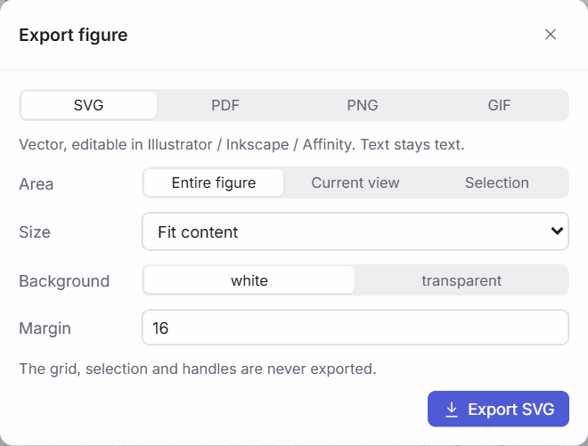

# Saving and exporting

## Projects

A **project** (`.gemsmap`) is one JSON file with everything a figure needs: the model, its template mapping profile, datasets and conditions, the drawing, the visual mappings, the view, styles and saved views. Biology/data and visuals are kept in separate parts of the file, so either can be replaced, for example a newer model under the same figure.

| *File* menu | Shortcut | |
| --- | --- | --- |
| New project | | An empty project: no drawing, data or model. A model returns as soon as you add something from COBRAGUI or import one. |
| Open example (central carbon metabolism) | | The built-in example with its demonstration model and data. |
| Open project… | ++ctrl+o++ | A `.gemsmap` file (or a `.metmap` file from versions ≤ 0.2). You can also drop it on the window. |
| Save project (.gemsmap) | ++ctrl+s++ | Downloads the project file. |
| Download model as COBRA JSON | | The map's model as a COBRApy-readable JSON file. |

**Autosave.** Every 5 minutes, if something changed, the Map Builder writes the current project to a temporary session in the browser (models larger than about 2 MB go to IndexedDB). The app **always opens clean** and never reopens anything by itself: a welcome banner offers to **continue the last session**, **download it** as a `.gemsmap` file, or **reopen the last COBRAGUI model** — so a session that freezes the page can never lock the app. The temporary session before the current one is kept as a spare. Autosave is a safety net, not an archive: it lives in one browser profile, so save important figures as files (Ctrl S). While a template is open in the Templates workspace, the map's autosave is never overwritten.

## Exporting a figure

**Export** (top right, or ++ctrl+e++) opens the export dialog.

<figure class="gm-shot gm-narrow" markdown>

<figcaption>The export dialog. The grid, the selection and handles are never exported.</figcaption>
</figure>

| Format | Use | Notes |
| --- | --- | --- |
| **SVG** | Journals, further editing in Illustrator, Inkscape or Affinity | Vector; text stays text; dimensions in millimetres. |
| **PDF** | Vector PDF | Through the browser's print dialog: choose *Save as PDF*. |
| **PNG** | Slides, documents | 150, 300 or 600 dpi, with the resolution stored in the file. White or transparent background. |
| **GIF** | Animated comparison of conditions | See below. |

**Area**: the entire figure, exactly what is framed on the canvas now, or the selection. **Size**: *Fit content*, or a journal preset — single column (89 mm), 1.5 column (120 mm), double column (183 mm), full page (183 × 247 mm), A4, a 16:9 slide — or a custom width and maximum height in mm. SVG and PDF files carry these physical dimensions; PNG files carry the chosen resolution.

## Animated GIF

Export → **GIF** plays the figure through the conditions you tick, in the order of *Data → Conditions*. Arrow widths, colours, node sizes and plots change from one condition to the next.

| Option | Choices |
| --- | --- |
| Conditions | Any subset, at least two |
| Hold | Seconds per condition |
| Transition | Cut, quick, smooth or slow; smooth transitions interpolate widths, colours and node sizes |
| Resolution | 300, 600 (default) or 900 dpi at the chosen physical size |
| Labels | Show the condition name on each frame |
| Loop | Smooth loop back to the first condition |

Frames are capped at 8,000 px per side and 36 megapixels. If a large figure exported at its natural size hits the cap, the dialog says so; choose a journal width for the full resolution.

## Reusing a layout

- **Save as template** (right-click a selection) stores the selected part of a map under *Elements → My templates*. Bound metabolites and reactions are turned into compartment-free hints (`g6p`, `PFK`), so the drawing re-binds to other GEMs with [auto-bind](mapping-model-elements.md#slots-and-auto-bind).
- For reusable, identity-aware pathway templates with database identifiers, review and validation, use the [Template Builder](../templates/creating-templates.md).

**Next:** [Templates](../templates/index.md), to make a layout reusable across models.

