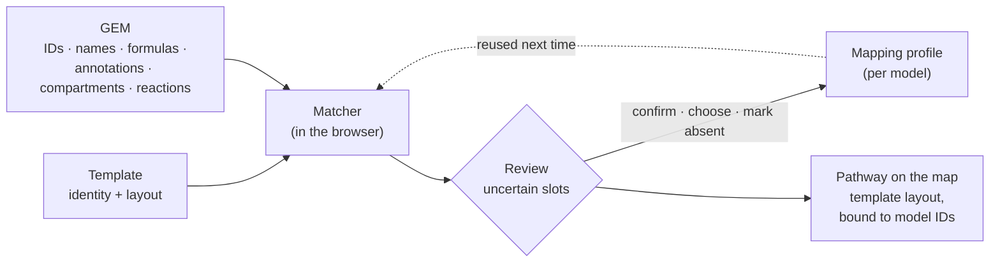

# Templates

A GEMsMAP **template** is a reusable pathway layout that knows **what each molecule is**, not what it is called in one particular model. The same template draws glycolysis on a BiGG model (`g6p_c`), a ModelSEED model (`cpd00079_c0`) or a KEGG-based model (`C00092[c]`), always with the same recognisable shape. A matcher finds the model's names for each molecule and asks you to review the uncertain cases.

> **A template describes biological identity and pathway topology; a GEM provides model-specific identifiers.**

## Why templates?

Drawing a clear pathway figure takes time, and most groups redraw the same pathways for every new model. Simply copying a map from one model to another rarely works, because each model uses its own identifiers, compartments and level of detail. A drawing that stores `g6p_c` breaks on a model that says `cpd00079_c0`.

Templates separate the parts that can be shared from the parts that cannot:

| Layer | What it is | Stored in |
| --- | --- | --- |
| **Visual layout** | Coordinates, arrows and their routing, labels, groups, repeated drawings of cofactors | The template |
| **Biological identity** | Which chemical each node stands for (names, synonyms, formula, database identifiers), in which conceptual compartment, and the stoichiometry of each reaction | The template |
| **Model-specific mapping** | Which metabolite and reaction of *this* GEM corresponds to each template node and arrow | The application: per-model *mapping profiles*, never the template file |

The layout is part of a pathway's identity: readers recognise a circular TCA cycle or a vertical glycolysis at a glance. That is why mapping never moves template nodes.

![Diagram: on the figure a node is labelled G6P (a display label). In the template it stands for D-glucose 6-phosphate in the cytosol, with KEGG C00092, BiGG g6p and ModelSEED cpd00079. The matcher finds it as g6p_c in a BiGG-style model, cpd00079_c0 in a ModelSEED model and C00092[c] in a KEGG-based model. A legend explains the four layers: display label, model ID, cross-database identifier, compartment-qualified identity.](../assets/diagrams/identity-layers.svg){ .gm-diagram }

## From a template to a pathway on your model

1. The **matcher** scores every model metabolite against every template node, using identifiers, names, formula, compartment and the reactions that connect neighbouring nodes.
2. High-confidence matches are applied; medium ones are applied provisionally and marked; ambiguous or missing ones stay **open**.
3. You **review** only what needs a person; your decisions go into the model's mapping profile.
4. The pathway is drawn with the template's layout and bound to the model's IDs, so results from COBRAGUI colour it immediately.

See [Identity and matching](identity-and-matching.md) for the details, and [Linking a map to a model](../maps/mapping-model-elements.md#pathway-templates) for the workflow on screen.

## What exists today, and what is planned

| Capability | Status |
| --- | --- |
| Built-in templates: global central carbon, glycolysis, TCA cycle, oxidative PPP | Implemented |
| KEGG-derived templates (map00010, map00020, map00030, map00250) and an amino acid overview, drafted with an LLM | AI-generated, awaiting review |
| Template Builder: create, edit, duplicate, validate, import and export templates without a model | Implemented |
| Identity search (GEMsMAP library offline; KEGG, ChEBI, MetaNetX online; local BiGG tables), *Auto Identify*, *Add BiGG IDs* | Implemented |
| Deterministic matching with evidence, review dialog, mapping profiles, reproducibility report | Implemented |
| Sharing templates as files (`.gemsmap-template.json`) | Implemented |
| A searchable community template hub with versions, provenance and review | Future direction |
| Drafting a template with the LLM of your choice (outside the application) and reviewing it in the Template Builder | Works today · needs review |
| Escher maps from BiGG as templates; more pathways (glyoxylate shunt, β-oxidation, oxidative phosphorylation…) | Planned |

## In this section

-   [**Template library**](template-library.md)

    The built-in templates, what they contain and how they map.

-   [**Identity and matching**](identity-and-matching.md)

    Entities, identifiers, compartments, scores, statuses and profiles.

-   [**Creating templates**](creating-templates.md)

    The Template Builder: drawing, defining identities, validating, exporting.

-   [**Sharing and reuse**](sharing-and-reuse.md)

    Template files today; a community library as the long-term vision.

-   [**Templates drafted with an LLM**](ai-assisted-templates.md)

    How any LLM can draft a template for you to review, and its limits.

