# Quick start: from model to map with *E. coli* iJO1366

This tutorial walks through GEMs MAP from start to finish with a real genome-scale model. You will import *E. coli* iJO1366, simulate it with and without oxygen, compare the two solutions, and turn the comparison into an annotated pathway map. Each step tells you **what to do**, explains **the idea behind it**, and shows **what you should see**.

| | |
| --- | --- |
| **Time** | about 45 minutes |
| **You need** | GEMs MAP installed and running ([Before you start](#before-you-start-install-gems-map), below) and an internet connection to download the model |
| **Model** | *Escherichia coli* str. K-12 substr. MG1655, **iJO1366** (Orth *et al.*, 2011): 2,583 reactions, 1,805 metabolites, 1,367 genes |
| **You will learn** | COBRAGUI: import, explore, medium, pFBA, results, comparison, subsystem figures · Map Builder: datasets, templates, mappings, plots, collapsing, connected reactions, routes |

!!! warning "Your numbers may differ slightly"
    The growth rates in this tutorial are reproducible. Individual fluxes and the counts derived from them can change a little between runs, because a model usually has many equally optimal flux distributions and pFBA returns one of them (see [Constraint-based analysis](../cobra-gui/constraint-based-analysis.md#fba-flux-balance-analysis)). If you see, for example, 26 instead of 30 reactions *activated from zero*, nothing is wrong.

## Before you start: install GEMs MAP

GEMs MAP is installed with pip in a **Python environment of its own**: a folder with its own copy of Python and its own libraries, so GEMs MAP cannot interfere with your other projects, and deleting the folder removes it. You need Python 3.10 or newer. The whole sequence is: open a terminal, **make a folder**, **create the environment** in it, **activate** it, **update pip**, **install** GEMs MAP and **start** it.

=== "Windows"

    In **PowerShell** (press the ++windows++ key, type *PowerShell*, press ++enter++), one line at a time:

    ```powershell
    mkdir $HOME\gemsmap
    cd $HOME\gemsmap
    python -m venv .venv
    .\.venv\Scripts\Activate.ps1
    python -m pip install --upgrade pip
    pip install gemsmap
    gemsmap
    ```

=== "macOS"

    In **Terminal**, one line at a time:

    ```bash
    mkdir ~/gemsmap
    cd ~/gemsmap
    python3 -m venv .venv
    source .venv/bin/activate
    python -m pip install --upgrade pip
    pip install gemsmap
    gemsmap
    ```

=== "Linux"

    In a terminal, one line at a time:

    ```bash
    mkdir ~/gemsmap
    cd ~/gemsmap
    python3 -m venv .venv
    source .venv/bin/activate
    python -m pip install --upgrade pip
    pip install gemsmap
    gemsmap
    ```

After the activation, the line where you type starts with `(.venv)`. The installation downloads a few hundred MB and can take several minutes. The last command opens GEMs MAP in your browser; keep the terminal open while you work through the tutorial.

If a command fails, or you want to know what each one does and what you should see, follow [Step by step: install with pip](../getting-started/installation.md#step-by-step-install-with-pip). It also covers the most common surprises: `py` instead of `python` on Windows, PowerShell refusing to run the activation script, and the missing venv module on Ubuntu. If you prefer not to install Python, the [Installation](../getting-started/installation.md#install) page has two other ways (uv and a double-click zip).

!!! tip "Already installed?"
    Open a terminal, go to the folder, activate the environment and start: `cd $HOME\gemsmap`, `.\.venv\Scripts\Activate.ps1`, `gemsmap` on Windows; `cd ~/gemsmap`, `source .venv/bin/activate`, `gemsmap` on macOS and Linux.

---

## Part 1 · COBRAGUI

### Step 1 — Import the model

1. Download **iJO1366** from BiGG Models: open [bigg.bio/models/iJO1366](https://bigg.bio/models/iJO1366) and download the **JSON** file, or download it directly from `http://bigg.ucsd.edu/static/models/iJO1366.json` (2.8 MB).
2. Open GEMs MAP. It starts in **COBRAGUI**.
3. **Drag `iJO1366.json` onto the window**, or click **Import model** and choose the file.
4. Wait a few seconds while COBRApy reads the model. The **Overview** opens.

<figure class="gm-shot" markdown>
[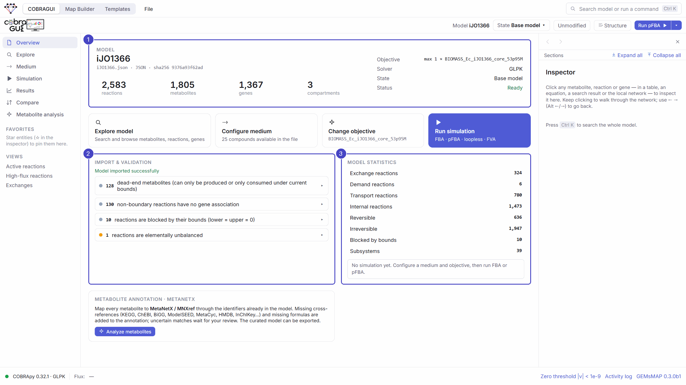](../assets/images/tutorials/quickstart-01-overview-annotated.png)
<figcaption markdown="span">iJO1366 imported: (1) the model card, (2) validation notes, (3) the reactions by type.</figcaption>
</figure>

!!! info "The idea behind it"
    COBRApy reads and validates the file in the local backend; your browser never computes fluxes. GEMs MAP keeps a copy of the file and identifies it by its checksum, so every result you compute later records exactly which model produced it. The original file is never modified.

    The start screen also offers *E. coli iJO1366* as an example bundled with COBRApy. It is the same reconstruction, but downloading the BiGG file makes your work reproducible with a file you can cite and share.

### Step 2 — Get to know the model

1. On the **Overview**, read **Model statistics**: 324 exchange, 6 demand, 780 transport and 1,473 internal reactions; 636 reversible and 1,947 irreversible; 39 subsystems. Click any line, for example *Exchange reactions*, to open those reactions in the Explorer.
2. Read **Import & validation**: each note (dead-end metabolites, reactions without genes…) expands to the IDs involved.
3. Click **Explore** in the left sidebar, then the **Reactions** tab.
4. Look at the **subsystem browser** on the left of the table: every subsystem with its number of reactions. Click **Glycolysis/Gluconeogenesis** to filter the table; click it again to clear the filter.
5. Type `pyruvate` in the search box: it searches IDs, names, equations, genes, subsystems and EC numbers at once.

<figure class="gm-shot" markdown>
[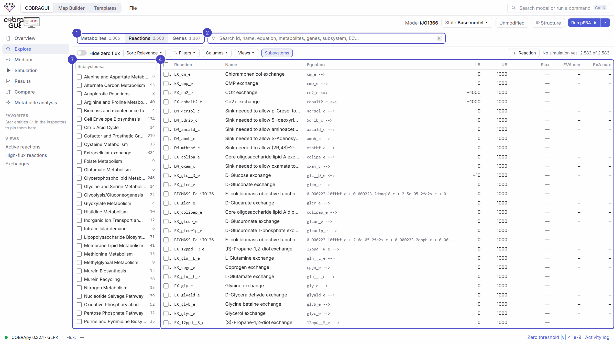](../assets/images/tutorials/quickstart-02-explore-annotated.png)
<figcaption>(1) Metabolites, Reactions and Genes tables, (2) search, (3) subsystem browser, (4) the reaction table.</figcaption>
</figure>

!!! info "The idea behind it"
    A genome-scale model is too large to read as a list. Subsystems are the pathway labels its authors attached to reactions; they are the quickest way into a part of metabolism. Exchange reactions connect the model to its environment (the medium), transport reactions move metabolites between compartments, and internal reactions are the metabolism itself.

### Step 3 — Inspect a metabolite in the side panel

1. Click the **Metabolites** tab and search `pyr_c`.
2. Click the row **pyr_c — Pyruvate**. The **inspector** on the right shows it.
3. Look at the tools at the top of the inspector: **Add to map**, **Connected reactions**, **Copy**, **Edit**, **Boundary** (create an exchange, sink or demand), **New reaction with it**, and the ☆ to add it to *Favorites*.
4. Scroll down: formula, charge, compartment, the reactions that produce and consume pyruvate, and a small **local network**.
5. Click any reaction in the list, then a metabolite in its equation: you are walking through the network. Use the ← → arrows at the top of the inspector (or ++alt+left++ / ++alt+right++) to go back and forward.

<figure class="gm-shot gm-narrow" markdown>

<figcaption markdown="span">Pyruvate before any simulation: its reactions are listed *as written* in the model.</figcaption>
</figure>

!!! info "The idea behind it"
    Before a simulation, GEMs MAP can only say which reactions *could* produce or consume pyruvate, according to the side of the equation (*Produced by (as written)*). That is **connectivity**, not flux. After the simulation in the next step, the same lists split by the direction in which each reaction actually runs. More in [Metabolite analysis](../cobra-gui/metabolite-analysis.md).

### Step 4 — Simulate with pFBA and name the result `run_o2`

1. Click **Simulation** in the sidebar.
2. Choose the **pFBA** card. The objective is the model's biomass reaction (`BIOMASS_Ec_iJO1366_core_53p95M`) and the medium is the one stored in the file (glucose, aerobic).
3. Click **Run pFBA**. After a few seconds the result card shows **Optimal** and an objective of about **0.982 h⁻¹**.
4. Click **Results** in the sidebar. Click **Rename** (or double-click the title), type `run_o2` and press ++enter++.
5. Browse the tabs: **Reactions** (flux of each reaction), **Metabolites** (turnover), **Exchanges** (what the cell takes up and secretes), **Subsystems**, **Genes**, and **How was this generated?** (the full provenance).

<figure class="gm-shot" markdown>
[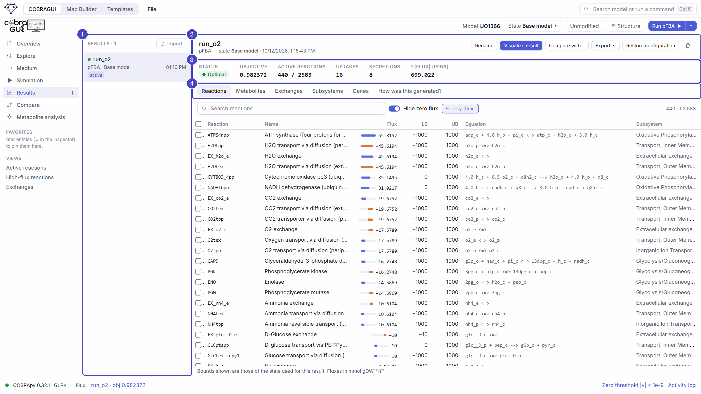](../assets/images/tutorials/quickstart-04-results-run-o2-annotated.png)
<figcaption markdown="span">(1) The result history, (2) title and actions (*Rename*, *Visualize result*, *Compare with…*, *Export*), (3) summary, (4) views of the result.</figcaption>
</figure>

!!! info "The idea behind it"
    **FBA** finds a flux distribution that maximises growth subject to mass balance and the reaction bounds. Many distributions usually reach the same maximum. **pFBA** picks, among them, one that needs the least total flux, which is a more reproducible and enzyme-economical choice. The objective value is the growth rate (h⁻¹); fluxes are in mmol gDW⁻¹ h⁻¹. Every result stores its model, state, medium, objective, solver and time, so naming it is all you need to find it again.

### Step 5 — Remove oxygen and simulate again: `run_wo2`

1. Click **Medium** in the sidebar. The table lists the compounds the cell may take up, with their maximum uptake.
2. Type `EX_o2_e` in the search box (typing `o2` also finds CO₂, Co²⁺ and others). The row is **O2 — EX_o2_e**, with a maximum uptake of 1000.
3. Click the **Max uptake** cell, type `0` and press ++enter++. The row leaves the *Available only* list, because oxygen is no longer available; switch to **All exchanges** to see it with *Model file* **1000 → 0**. The top bar now says **Modified · 1**.
4. Go to **Simulation** and click **Run pFBA** again. The growth rate drops to about **0.242 h⁻¹**.
5. In **Results**, rename this result `run_wo2`.

<figure class="gm-shot" markdown>
[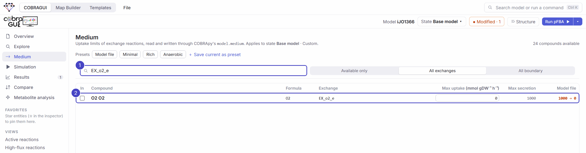](../assets/images/tutorials/quickstart-05-medium-o2-annotated.png)
<figcaption markdown="span">(1) Search by exchange ID, (2) oxygen uptake set to 0: the change from the model file is highlighted.</figcaption>
</figure>

!!! info "The idea behind it"
    The **medium** is the set of uptake limits of the exchange reactions. Setting the oxygen uptake to zero asks the model how *E. coli* grows anaerobically on glucose. The change is recorded in the active **model state**, not in the file, and the result `run_o2` keeps the configuration it was computed with. Tip: for longer studies, use **State → Duplicate** to keep each condition as its own named state (see [Medium, bounds and objective](../cobra-gui/constraints.md#model-states)).

### Step 6 — Compare `run_o2` and `run_wo2`

1. Click **Compare** in the sidebar (or **Compare with…** on a result).
2. Choose **A = `run_o2`** (the reference) and **B = `run_wo2`**.
3. Open **Metric** and look at the four options: **Δ = B − A**, **|Δ|**, **log₂ fold change |B|/|A|** and **fold change |B|/|A|**. Choose **log₂ fold change**.
4. Click **Compare**.

<figure class="gm-shot" markdown>
[](../assets/images/tutorials/quickstart-06-compare-annotated.png)
<figcaption markdown="span">(1) What is compared and how, (2) the configuration difference: only the oxygen uptake, (3) the objective and the categories of change, (4) the tables.</figcaption>
</figure>

!!! info "The idea behind it"
    GEMs MAP first lists **what differs between the two runs** (here only `EX_o2_e`), so you know what you are comparing. Then it **classifies every reaction before computing any ratio**: *changed*, *unchanged*, *activated from zero*, *inactivated to zero*, *direction reversal*. A fold change is not defined for a reaction that starts or stops, or that runs the other way, so those are counted separately instead of being hidden in a number. log₂FC compares magnitudes: +1 means twice the flux, −1 half.

Now use the comparison to answer some questions. The filter menu above the table (*Differing only*) selects the categories.

**Which reactions were switched on without oxygen?** Choose **Activated from zero**.

<figure class="gm-shot" markdown>
[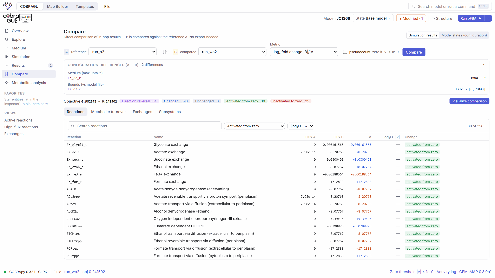](../assets/images/tutorials/quickstart-07-activated.png)
<figcaption>Reactions that carry flux only without oxygen.</figcaption>
</figure>

You should find the secretion of fermentation products (`EX_ac_e` acetate, `EX_etoh_e` ethanol, `EX_for_e` formate, `EX_succ_e` succinate), the ethanol pathway (`ACALD`, `ALCD2x`), and oxygen-independent versions of enzymes that normally use O₂: `CPPPGO2` (coproporphyrinogen oxidase) and `DHORDfum` (dihydroorotate dehydrogenase with fumarate).

**Which reactions were switched off?** Choose **Inactivated to zero**. You should find oxygen uptake (`EX_o2_e`), the cytochrome oxidase (`CYTBO3_4pp`), 2-oxoglutarate dehydrogenase (`AKGDH`), the oxidative pentose phosphate pathway (`G6PDH2r`, `GND`) and the O₂-dependent enzymes replaced above (`CPPPGO`, `DHORD2`).

**Which metabolites were affected?** Open the **Metabolite turnover** tab: O₂ turnover collapses, formate rises strongly, CO₂ falls, and TCA intermediates such as succinyl-CoA and malate fall. Click a metabolite to see **which reactions explain its change**.

**What does the cell exchange with the medium?** Open the **Exchanges** tab: uptake and secretion per compound in A and B. Nutrients such as ammonium and phosphate are taken up less, because the cell grows about four times more slowly.

<figure class="gm-shot" markdown>
[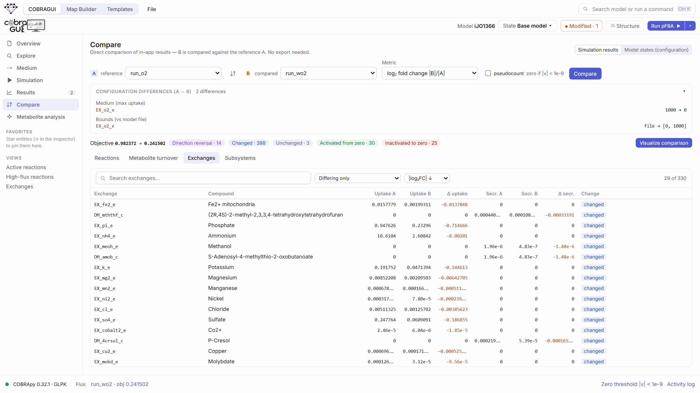](../assets/images/tutorials/quickstart-08-exchanges.png)
<figcaption>Uptake and secretion compared, compound by compound.</figcaption>
</figure>

!!! warning "Descriptive, not causal"
    These are differences between two optimal solutions of a model. They show how the model *can* adapt, not a measurement, and another optimal solution may route some fluxes differently.

### Step 7 — Compare by subsystem and make a figure

1. Still in **Compare**, open the **Subsystems** tab. The list on the left ranks subsystems by how much their total flux changed; the dumbbell shows A (light) and B (dark).
2. Click **Glycolysis/Gluconeogenesis**. The **List** view shows each reaction's flux in A and B.
3. Switch the view to **Bars**, **Heatmap** and **Donut**. These are publication figures, sized for a journal column.

<div class="grid" markdown>

<figure class="gm-shot" markdown>
[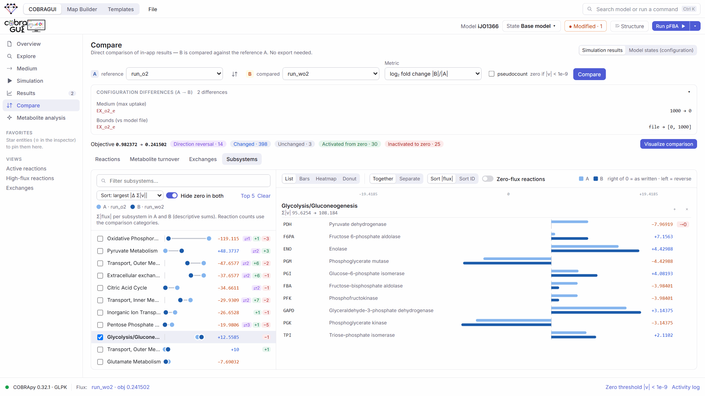](../assets/images/tutorials/quickstart-09-glycolysis-list.png)
<figcaption>List</figcaption>
</figure>

<figure class="gm-shot" markdown>
[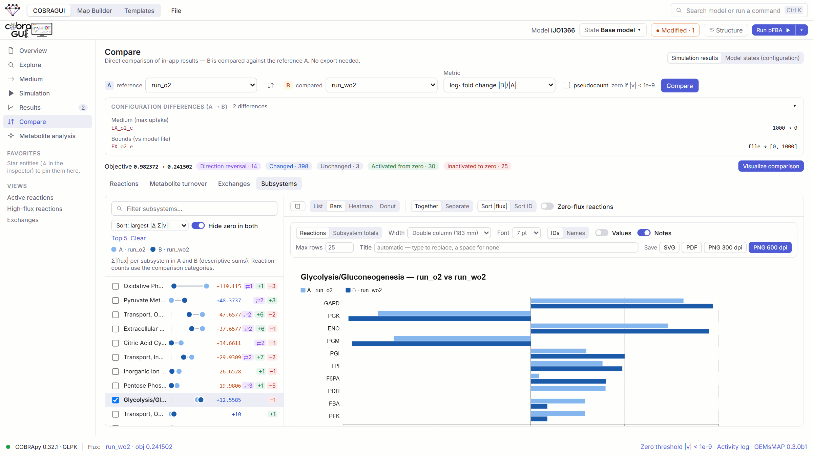](../assets/images/tutorials/quickstart-10-glycolysis-bars.png)
<figcaption>Bars</figcaption>
</figure>

<figure class="gm-shot" markdown>
[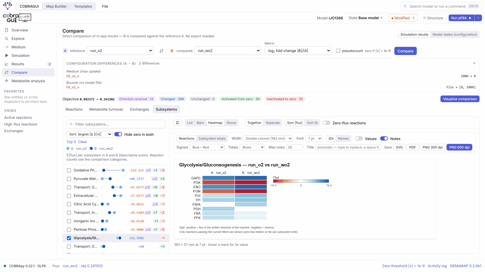](../assets/images/tutorials/quickstart-10-glycolysis-heatmap.png)
<figcaption>Heatmap</figcaption>
</figure>

<figure class="gm-shot" markdown>
[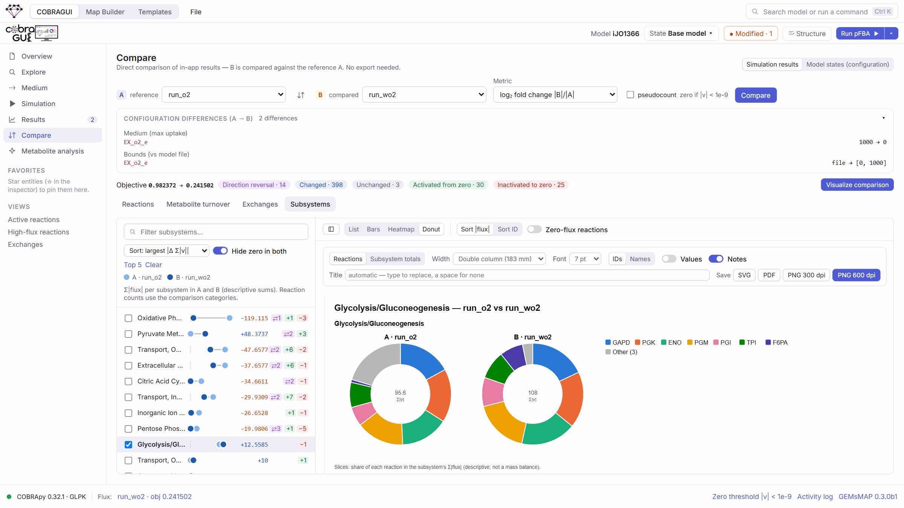](../assets/images/tutorials/quickstart-10-glycolysis-pie.png)
<figcaption>Donut</figcaption>
</figure>

</div>

4. Go back to **Bars** and also tick **Citric Acid Cycle** in the list.
5. Choose **Together** (one chart, one scale) or **Separate** (one panel per subsystem; then *Shared scale* or *Own scale*).
6. In the figure options choose **IDs** or **Names** for the reactions, and optionally *Values*, the width (single, 1.5 or double column), the font size and a title.
7. **Save** the figure as **SVG**, **PDF** or **PNG** (300 or 600 dpi).

<figure class="gm-shot" markdown>
[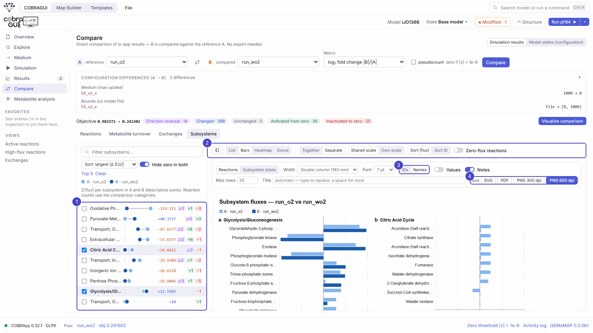](../assets/images/tutorials/quickstart-11-glycolysis-tca-separate-annotated.png)
<figcaption markdown="span">(1) Subsystems to show, (2) view, together/separate and scale, (3) reaction IDs or names, (4) export.</figcaption>
</figure>

!!! info "The idea behind it"
    Subsystem totals (Σ|flux|) give the global picture; opening a subsystem shows which of its reactions moved. Bars and heatmaps compare values; the donut only shows how Σ|flux| is shared within the selected subsystems, because Σ|flux| values are not parts of a natural whole. The figures are vector graphics sized in millimetres, ready for a paper.

---

## Part 2 · The Map Builder

### Step 8 — Send the comparison to the Map Builder

1. Click **Map Builder** in the workspace switcher (top left). If a figure is already open, for example the built-in example, choose **File → New project** to start from an empty canvas.
2. Go back to the **COBRAGUI → Compare** and click **Visualize comparison**.
3. In the dialog keep **log₂FC of |flux| → edge colour** and **width = |flux| in B**, then click **Send to Map Builder**. (If the Map Builder holds another model, GEMs MAP asks before replacing it: confirm.)
4. In the Map Builder, open the **Data** tab of the left panel: the data are already there.

<div class="grid" markdown>

<figure class="gm-shot" markdown>
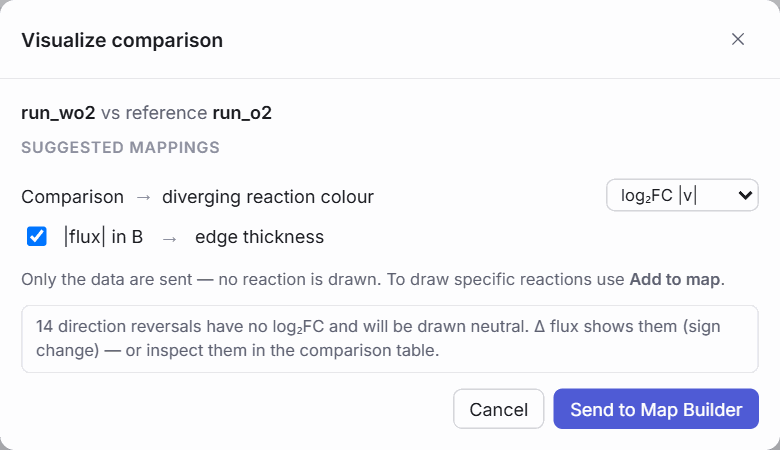
<figcaption>Only data are sent; nothing is drawn yet.</figcaption>
</figure>

<figure class="gm-shot" markdown>
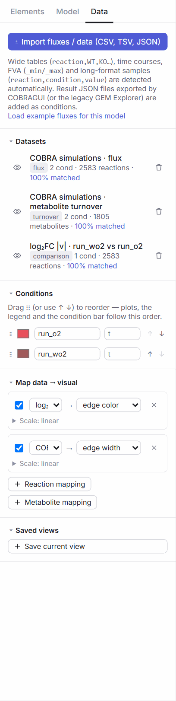
<figcaption>Datasets, conditions and mappings in the Data tab.</figcaption>
</figure>

</div>

!!! info "The idea behind it"
    The Map Builder receives **data**, not a drawing: three datasets (fluxes, metabolite turnover and the log₂FC comparison), one **condition** per result, and suggested **mappings** from data to colour and width. Because the map uses the same model IDs as COBRApy, any arrow bound to a reaction picks up its value automatically. Next you draw the pathway.

### Step 9 — Insert the global central carbon metabolism template

1. Open the **Elements** tab and click **Global central carbon metabolism** under *Pathway templates*.
2. The **mapping review** opens: GEMs MAP has searched iJO1366 for every metabolite of the template. On a fresh installation you should see **25 mapped, 1 to review**: *D-Ribose 5-phosphate* → `r5p_c`, provisionally, with medium confidence. Click it and *why?* to see the evidence, and keep `r5p_c`; it is the right metabolite. (If you ran the [metabolite analysis](../cobra-gui/metabolite-analysis.md#curating-identifiers-with-metanetx) on this model before, all 26 may be mapped automatically.)
3. Note the message about the TCA cycle: it is mitochondrial in eukaryotes, and since *E. coli* has no mitochondria, it was searched in the cytosol.
4. Click **Create pathway**. A preview follows your mouse: **click where it should go**. Then press ++f++ to fit the view.

<figure class="gm-shot gm-medium" markdown>

<figcaption>The mapping review: only what needs a person is listed.</figcaption>
</figure>

<figure class="gm-shot" markdown>
[](../assets/images/tutorials/quickstart-15-central-carbon-map.png)
<figcaption>The pathway drawn with the template's layout and coloured by the comparison.</figcaption>
</figure>

!!! info "The idea behind it"
    A template stores **what each molecule is** (names, formula, database identifiers) and **the layout**, never model IDs. The matcher finds the model's names for each molecule and leaves uncertain cases to you, because an open slot is better than a wrong one. Your decisions are remembered for this model. See [Identity and matching](../templates/identity-and-matching.md).

### Step 10 — Change how the data are drawn

1. Open the **Data** tab. Under **Map data → visual**, each row is a mapping: *dataset → property*.
2. Change a property in the second menu: for reactions **edge width**, **edge color**, **opacity** or **label**. Click *Scale* to choose linear, square-root, log or percentile, the **palette** and the min/max.
3. Click **+ Metabolite mapping**: it uses the metabolite turnover dataset. Change its property to **node fill**: nodes are now coloured by turnover. *Node radius* and *opacity* are the other options.

<figure class="gm-shot" markdown>
[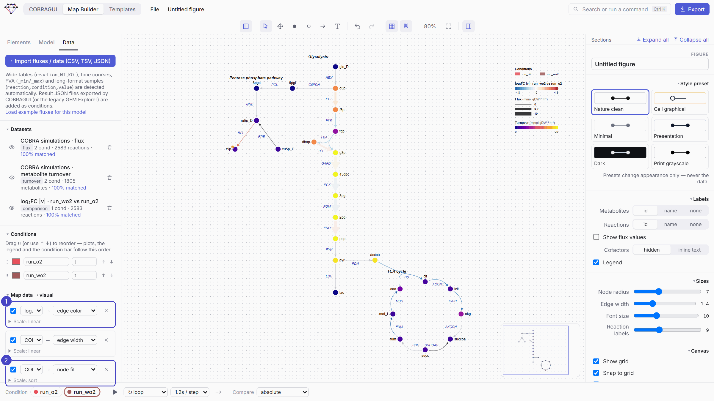](../assets/images/tutorials/quickstart-16-mappings-annotated.png)
<figcaption markdown="span">(1) Reaction mapping to edge colour, (2) the new metabolite mapping to node fill.</figcaption>
</figure>

!!! info "The idea behind it"
    Data and drawing are separate: the same map can show fluxes as width and a comparison as colour, and switching a mapping never changes the data. The arrowhead always follows the sign of the flux, zero flux is drawn thin and grey, and colour scales are computed over all conditions, so switching condition never silently rescales the map.

### Step 11 — Move around the map

- Press ++c++ (the hand tool) and drag to pan; press ++v++ to go back to selecting. You can also hold ++space++ and drag, or drag with the right mouse button.
- Scroll the mouse wheel to zoom; ++f++ fits everything; the minimap in the corner shows where you are.

!!! tip "Make C and V a habit"
    Switching between ++c++ (move) and ++v++ (select), with the mouse wheel for zoom, is the recommended way to work in the Map Builder for the rest of this tutorial and in your own projects. With the hand, a drag never moves or selects anything by accident.

### Step 12 — Look at PGK and plot it

1. **Right-click the PGK arrow** (or its label). A menu opens with the actions for this reaction: *Add linked plot* (density, bar, line, heatmap, box, FVA range), *Reverse drawn direction*, straight / curved / orthogonal routing, *Flip label side*, *Collapse into summary arrow*, *Find routes in the model…*, *Lock*, *Duplicate*… At the same time the inspector on the right shows the reaction.
2. Press ++escape++ to close the menu and **click** PGK to select it again.
3. Explore the inspector: the equation, the **participants** shown on this arrow, the **flux** in each condition (about 16 in `run_o2` and 19 in `run_wo2` mmol gDW⁻¹ h⁻¹), bounds, genes, EC number, and **Appearance**: label (global, ID, name or your own text), routing, solid or dashed line, *Reverse*, *Flip label*. Fold or unfold sections by clicking their titles (*Expand all* / *Collapse all*); drag the left edge of the panel to make it wider.
4. Under **Linked plots**, click **+ bar** (or use *Add linked plot → Bar* in the right-click menu). A small bar chart of PGK in both conditions appears next to the arrow and moves with it.

<div class="grid" markdown>

<figure class="gm-shot" markdown>
[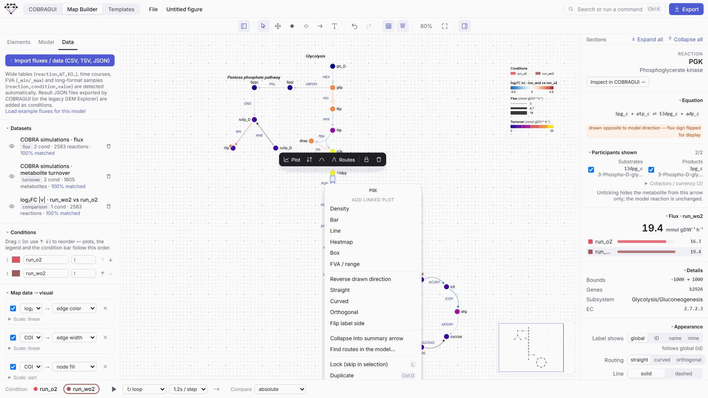](../assets/images/tutorials/quickstart-17-pgk-context-menu.png)
<figcaption>Right-click: the actions of the reaction.</figcaption>
</figure>

<figure class="gm-shot" markdown>
[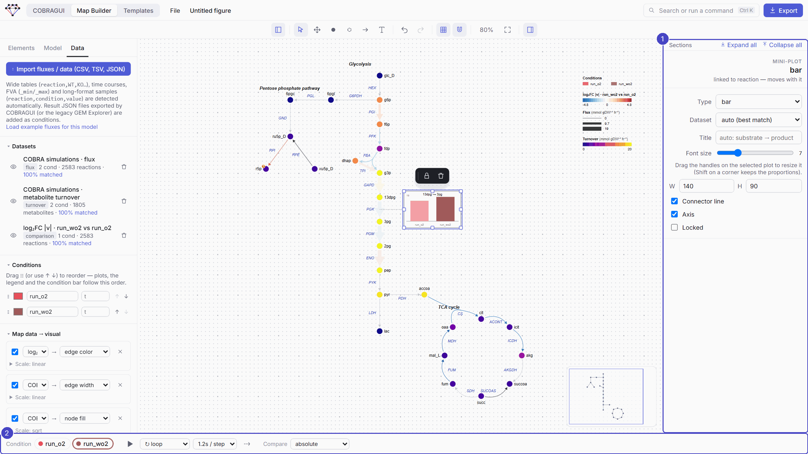](../assets/images/tutorials/quickstart-18-pgk-bar-plot-annotated.png)
<figcaption markdown="span">(1) The plot's settings, (2) the condition bar.</figcaption>
</figure>

</div>

!!! note "Drawn opposite to the model"
    The inspector of PGK says *drawn opposite to model direction — flux sign flipped for display*. iJO1366 writes the reaction as `3pg_c + atp_c ⇌ 13dpg_c + adp_c`, while glycolysis is drawn from 1,3-bisphosphoglycerate to 3-phosphoglycerate. GEMs MAP keeps the drawing readable and flips the sign of the flux for display, so the arrowhead still points the way the reaction runs.

### Step 13 — Switch, compare and animate conditions

At the bottom of the window, the **condition bar** controls the whole map:

- click **run_o2** or **run_wo2** (or press ++bracket-left++ / ++bracket-right++) to show one condition;
- **Compare** sets a comparison mode against a reference condition: *difference (Δ)*, *fold change* or *log₂ fold change*;
- ▶ plays through the conditions, in a loop, back and forth or once, at the chosen speed. With more than two conditions that have a time (*Data → Conditions*, field *t*), a timeline slider appears for time courses;
- **Export → GIF** turns the same animation into a file.

### Step 14 — Collapse PGM, ENO and PYK into one arrow

1. Click the **PGM** arrow, then hold ++shift++ and click **ENO** and **PYK**.
2. In the inspector, click **Collapse into one arrow**. The three reactions become one summary arrow from 3-phosphoglycerate to pyruvate.
3. With the summary arrow selected, click **+ heatmap**: a heatmap of the arrow's flux in each condition appears next to it.

<figure class="gm-shot" markdown>
[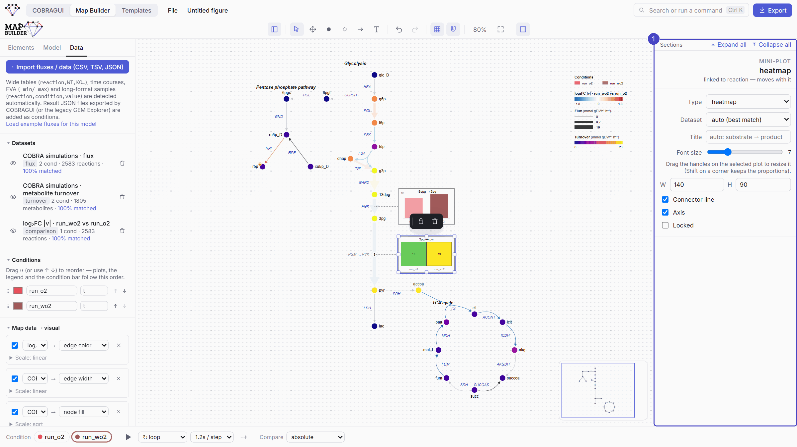](../assets/images/tutorials/quickstart-19-collapsed-heatmap-annotated.png)
<figcaption>Three reactions summarised by one arrow, with a heatmap.</figcaption>
</figure>

!!! info "The idea behind it"
    Collapsing simplifies a figure without losing information: the hidden reactions are stored inside the summary arrow, and **Expand back** restores them. The summary arrow's flux is the **net flux entering the segment** (about 14.6 in `run_o2` and 19 in `run_wo2` here); its inspector lists the hidden reactions with their own fluxes. In this solution `PYK` carries no flux in `run_wo2`; the next step shows which reactions make pyruvate instead. You can also choose sum, mean, minimum or maximum.

### Step 15 — Explore pyruvate and add ACLS

1. Click the **pyr** node (pyruvate). The inspector shows its **template mapping** (`pyr_c`, matched automatically; `pyr_e` and `pyr_p` are other compartments with low scores), its formula, its **turnover** in each condition, and its appearance (label, label position, radius, style, fill).
2. Under **Connected reactions**, tick **Hide zero-flux reactions**: of the 62 reactions of pyruvate in iJO1366, only those with flux in at least one condition remain. ↑ produces, ↓ consumes.
3. **Click a reaction chip** to see what it is: name, equation, subsystem, genes and bounds.
4. Click **ACLS** (acetolactate synthase, the first step towards valine, leucine and isoleucine) and **Add to the map**.
5. ACLS appears attached to pyruvate, with a new node for its product, which may land on top of something else. **Drag the new node** to a free spot.

<div class="grid" markdown>

<figure class="gm-shot" markdown>
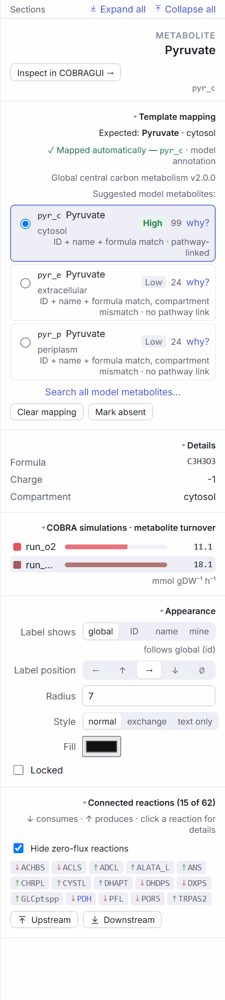
<figcaption>Pyruvate on the map.</figcaption>
</figure>

<figure class="gm-shot" markdown>
[](../assets/images/tutorials/quickstart-21-acls-card.png)
<figcaption>Click a chip to see the reaction before adding it.</figcaption>
</figure>

</div>

<figure class="gm-shot" markdown>
[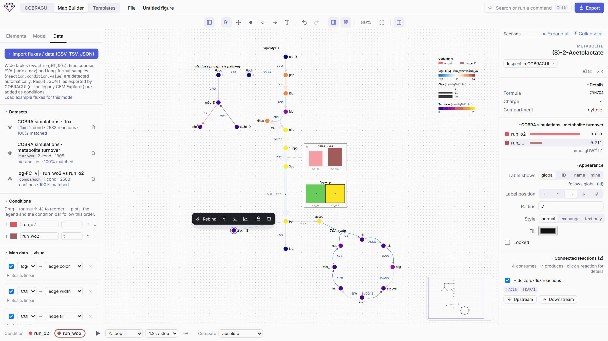](../assets/images/tutorials/quickstart-22-acls-added.png)
<figcaption>ACLS on the map, after moving its product node.</figcaption>
</figure>

!!! info "The idea behind it"
    Growing a map from the model keeps the drawing focused on what the data say matters: hiding zero-flux reactions leaves only the active neighbourhood. An added reaction brings its own copies of its other metabolites rather than connecting to nodes elsewhere. To join a copy with an existing node of the same metabolite, drag it onto that node and release when the green ring appears.

### Step 16 — Draw your own, or bring reactions from COBRAGUI

**Draw freely.** Press ++m++ and click the canvas to add a **metabolite** (choose it from the model), or ++s++ for an empty **slot** that you bind to a metabolite later. To draw a **reaction**, drag from the outer ring of one node to another; drop on empty canvas to create the next node of a chain. Arrows between two bound metabolites are bound to the model reaction that links them.

**Or start from COBRAGUI:**

1. Switch to **COBRAGUI** and click **Explore**.
2. In the left sidebar, under **Views**, click **Active reactions** (only reactions with flux, sorted by |flux|).
3. Search `OCBT` (ornithine carbamoyltransferase, in arginine biosynthesis) and click it.
4. In the inspector, click **+ Add to map**. GEMs MAP switches to the **Map Builder** with OCBT as a light preview that follows the mouse: click an empty area to place it (++esc++ cancels), then press ++f++. Its metabolites are new copies; drag one onto another node of the same metabolite to merge them.

<figure class="gm-shot" markdown>
[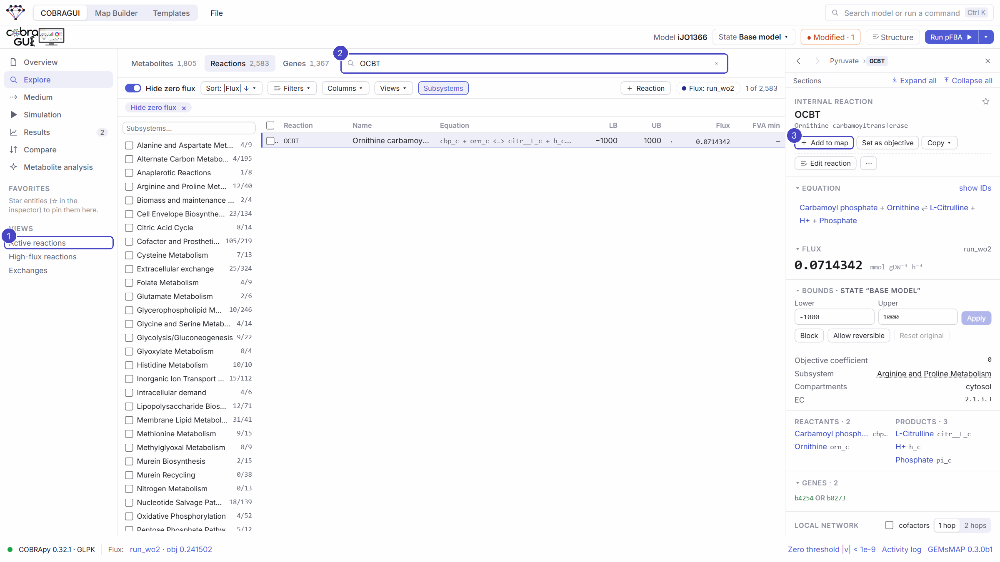](../assets/images/tutorials/quickstart-23-ocbt-add-annotated.png)
<figcaption markdown="span">(1) The *Active reactions* view, (2) search, (3) *Add to map*.</figcaption>
</figure>

### Step 17 — Add the amino acid biosynthesis template

Templates are pathway maps that know the identity of each molecule. The matcher proposes where each one is in your model, and a person reviews the result.

1. In the Map Builder, **Elements → Amino acid biosynthesis (overview)**.
2. The review reports **22 mapped and 10 to review**: glucose, 3-phosphoglycerate, tryptophan, leucine, lysine, threonine, methionine, isoleucine, arginine and histidine are proposed with medium confidence. Click each one to check its candidates and evidence; you could choose another candidate or *Mark absent* if the model did not contain it. Here all ten proposals are the right cytosolic metabolites (`glc__D_c`, `3pg_c`, `trp__L_c`…).
3. Click **Create pathway** and click an **empty area** to place it. Everything inserted stays selected, so you can drag it as one piece (or move it with ++shift++ + arrow keys). Press ++f++.

<figure class="gm-shot gm-medium" markdown>
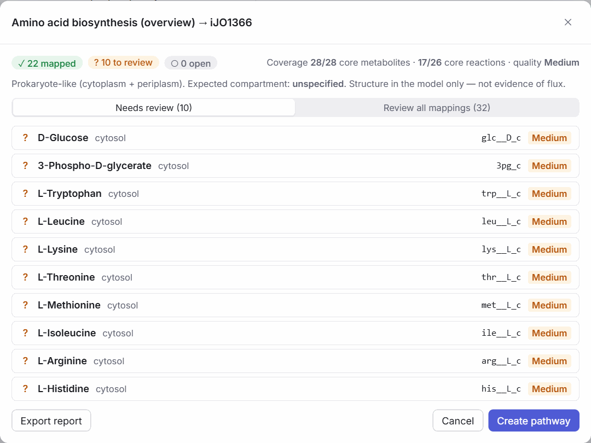
<figcaption>Ten provisional matches for a person to check.</figcaption>
</figure>

<figure class="gm-shot" markdown>
[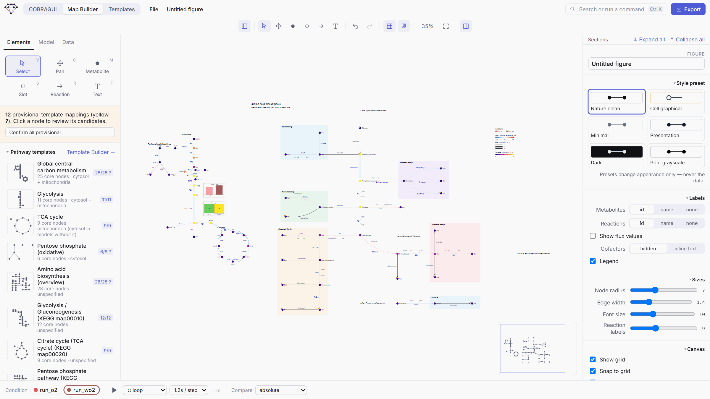](../assets/images/tutorials/quickstart-25-amino-acid-map.png)
<figcaption>Two templates on one map, both bound to iJO1366.</figcaption>
</figure>

!!! info "The idea behind it"
    The **? marks** on provisional nodes stay until you confirm them; *Elements → Confirm all provisional* accepts them all at once. The coverage line (17 of 26 core reactions) tells you how much of the template exists in the model *as single reactions*. Many arrows of this overview are **pathway summaries**: one arrow for a whole pathway, which a model implements in several steps. This template was drafted with an LLM and is marked *needs review* in the library; see [Templates drafted with an LLM](../templates/ai-assisted-templates.md).

### Step 18 — Find the route behind a summary arrow

1. Find the arrow **SerA·C·B** in the serine family: it goes from **3-phospho-D-glycerate** to **L-serine**.
2. Click it. The inspector says **Not bound to a model reaction**: in the model this conversion takes several reactions.
3. Click **Find routes 3pg_c → ser__L_c in the model…**.
4. Keep **Only routes that carry flux** (here in `run_wo2`). GEMs MAP finds **one route of 3 reactions: PGCD → PSERT → PSP_L**.
5. Click **Insert** to draw every step, or **Collapsed** to insert them as one summary arrow that you can expand later.

<figure class="gm-shot gm-medium" markdown>
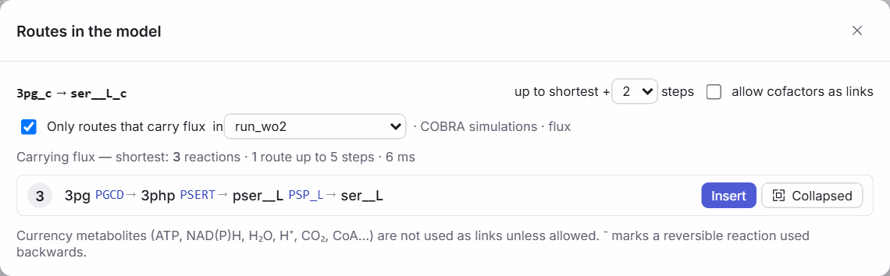
<figcaption>The serine pathway found in iJO1366, restricted to reactions with flux.</figcaption>
</figure>

<figure class="gm-shot" markdown>
[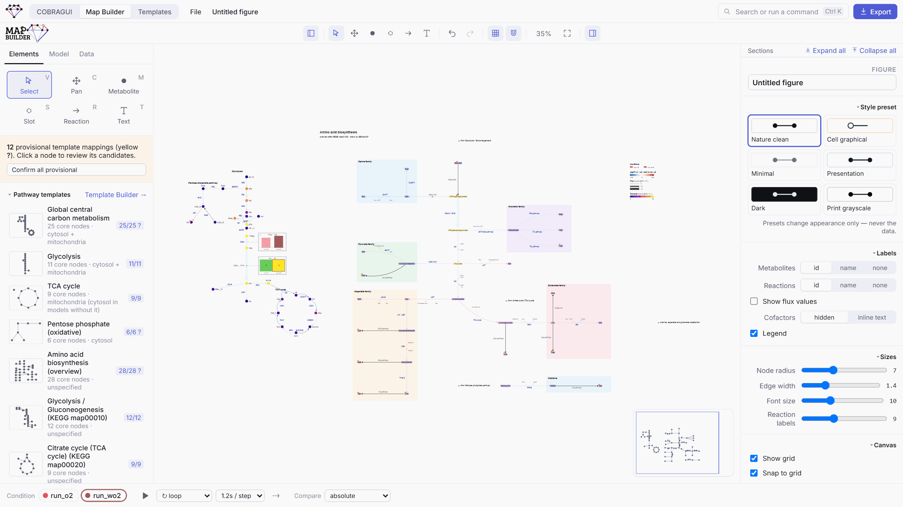](../assets/images/tutorials/quickstart-27-route-inserted.png)
<figcaption>The route inserted as one collapsed arrow.</figcaption>
</figure>

!!! tip "When to use routes"
    *Find routes* searches the model for chains of reactions between two metabolites, skipping cofactors such as ATP or NAD(H), and with flux data it keeps only routes whose every reaction carries flux in the direction used. It is very useful between **nearby** metabolites like these. Between distant metabolites the number of possible routes explodes and the result is hard to read; there, a template or a few steps of *Connected reactions* work better.

---

## What you have done

You imported a genome-scale model, explored its structure, simulated it in two conditions, compared the solutions with categories, metrics and subsystem figures, and turned the comparison into a pathway map. Along the way you used two templates, data mappings, linked plots, collapsing, connected reactions and route finding. From here:

- save your work with **File → Save project** (`.gemsmap`) and export figures with **Export** ([Saving and exporting](../maps/saving-and-exporting.md));
- browse the [COBRAGUI](../cobra-gui/index.md), [Maps](../maps/index.md) and [Templates](../templates/index.md) sections for every option;
- **next tutorial:** creating and reviewing your own templates (in preparation).

## Reference

Orth JD, Conrad TM, Na J, Lerman JA, Nam H, Feist AM, Palsson BØ (2011). A comprehensive genome-scale reconstruction of *Escherichia coli* metabolism—2011. *Molecular Systems Biology* 7:535. [doi:10.1038/msb.2011.65](https://doi.org/10.1038/msb.2011.65)

The screenshots of this tutorial were captured from GEMs MAP 0.2.0 with COBRApy 0.32.1 and GLPK, using `iJO1366.json` from BiGG (SHA-256 `9376a93f62ad430719f23e612154dd94c67e0d7c9545ed9d17a4d0c347672313`). The values the application displayed are recorded in `docs/assets/images/tutorials/quickstart-manifest.json`.
